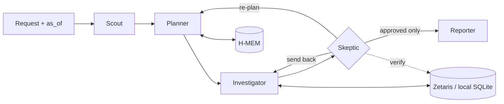

# SmartFlux EDIS

> *"TNB tells you what you spent. SmartFlux tells you what to do about it, and proves it worked."*

An agent that tells a Malaysian laundromat owner whether to install solar, switch tariff or both, finds the machines wasting energy, and proves whether each fix saved money.

**Open Agent Hackathon 2026 · Track 3: Reasoning Architecture**
Built with Zetaris · Meterless H-MEM · Meterless Nightshift · NVIDIA Nemotron · Claude Code

> **Status: in development.** Sample mode runs all eight examples end to end. The Zetaris and Nightshift adapters are built and tested against fakes of their APIs; the first run against the real services is pending (`pnpm smoke`). The API, the apps and Docker are next. See [TODO.md](TODO.md).

---

## The problem

A self-service laundromat owner sees one number: the monthly TNB bill. They don't know which machine, hour or tariff drives it. Since July 2025 they can opt into the Time-of-Use (ToU) tariff, and since January 2026 they can install rooftop solar under Solar ATAP. These two decisions interact, and installers size solar from the bill, not from when the load actually happens. Meanwhile a dryer with a clogged vent or a weak heater can waste about RM180 a month without anyone noticing, and nobody checks whether a fix worked.

## What it does

1. **Decides solar, ToU or both, jointly.** It sizes solar from the outlet's half-hourly load and real irradiance, then re-decides the tariff on the grid load that remains. For the example outlet: 10 kWp solar and stay on flat, about RM507/month.
2. **Finds wasteful machines without sensors.** It regresses meter intervals on the cycle logs the payment system already records. Electric dryers are tracked by kWh per cycle, gas dryers by cycle minutes.
3. **Acts only with approval, then verifies.** After the owner approves a fix, a later session measures the realised saving against the machine's remembered baseline and its peers.
4. **Works unprompted.** A Monday briefing for every outlet, plus Scope 2 emissions figures.

Every RM figure is computed by tested code, never by the LLM, and is re-checked by a Skeptic agent against the data before the owner sees it.

## Agents

| Agent | Model lane | Authority |
| --- | --- | --- |
| Scout | Fast | Classifies intent and risk; refuses out-of-scope requests |
| Planner | Fast | Forms hypotheses from the request and memory; re-plans when nothing survives |
| Investigator | none (tool runner) | Runs query templates through Zetaris and the calculators; never states a number it did not compute |
| **Skeptic** | Deep | Re-queries the data to verify each claim; **can send work back and block the Reporter**; rejects double-counted savings |
| Reporter | Deep | Writes decision cards in English or Malay from approved claims only |



## Quick start

Requires Node 22.13+ and pnpm.

```bash
# Sample mode: no credentials, no sponsor services, the real agent logic on cached data
pnpm install
pnpm agent --input input_examples/06-energy-plan.json     # prints every agent step (JSONL), then the result
pnpm agent --approve <action_id>                          # record the owner's decision in H-MEM
pnpm test                                                 # calculators, H-MEM, agents, live-path fakes
```

### Web app (customer, owner, admin)

```bash
pnpm web:build && pnpm start      # API + web app on http://localhost:8000
# or, while editing the UI: pnpm start  (one terminal)  +  pnpm web:dev  (Vite on :5173, proxies the API)
```

One app, three roles, picked at the demo login (no password):

| Role | Sees | Can do |
| --- | --- | --- |
| **Customer** (QR at the outlet: `/customer?outlet=OUT-01`) | Each machine as free, in use (minutes left) or under maintenance; owner-approved promos | Report a machine that isn't working |
| **Owner** (phone) | Weekly briefing, bill so far, energy plan, decisions with evidence, machines | Ask the agent, approve or reject actions |
| **Admin** (desktop) | Every outlet: KPIs, peak vs off-peak, flagged machines, advice scoreboard, run log | Export Scope 2 CSV |

The server checks the role and outlet on every route (signed token; `403` otherwise), so a customer can never read energy data or approve anything. A machine shows **under maintenance** only after the Skeptic approved the fault and the owner approved the service; a customer report is cited as supporting evidence but never flags a machine on its own. Use the date picker to replay the sessions (13 Sep → 4 Oct → 18 Oct).

### Live mode (Zetaris + Nightshift)

```bash
cp .env.example .env                       # fill in Zetaris, Postgres and Nightshift settings, SAMPLE_MODE=false
docker compose up -d smartflux-pg          # synthetic source data, loaded from data/sample on first start
pnpm zetaris:setup --dry-run               # review: datasource, Open-Meteo REST table, semantic layer
pnpm zetaris:setup                         # create them (add --weather pg if the REST unnest fails)
pnpm smoke                                 # Zetaris checks + template parity, Nightshift lanes
pnpm agent --input input_examples/02-bill-why.json
```

Each side can go live on its own (`DATA_MODE=zetaris` or `LLM_MODE=nightshift`). If a live service fails mid-run, that step retries, then uses its local twin (SQLite or the rules reasoner), and the run is marked `mixed`.

## Sponsor technology

| Sponsor | Where | What it does |
| --- | --- | --- |
| **Zetaris** | `apps/backend/src/adapters/zetaris.ts`, `infra/zetaris/` | The only live data path. A Postgres datasource (meter readings, machine cycles, tariffs, service log, solar parameters, holidays) and a live REST table (Open-Meteo weather and radiation) sit behind a semantic layer (`smartflux.energy`) that holds the peak/off-peak/holiday rule once. Every query template, including the Skeptic's verification queries, runs here. The adapter is read-only (SELECT/SHOW/DESCRIBE), sends one statement per call, and binds parameters through a whitelist. |
| **Meterless H-MEM** | `apps/backend/src/engines/hmem/` | Tiered memory with ranked, `as_of`-scoped recall and a JSONL trust ledger (`logs/hmem-ledger.jsonl`). It holds each machine's baseline, every piece of advice, the owner's approvals and rejections, and measured outcomes, so later sessions verify earlier advice. The recall is injected into the Planner's prompt. Tested in `memory.test.ts`. |
| **Meterless Nightshift** | `apps/backend/src/adapters/llm.ts` | The only AI provider: one injected generator (the Meterless engine rule), OpenAI-format, with the `meterless-app` and `meterless-scope` headers. |
| **NVIDIA Nemotron** | via Nightshift lanes | The fast lane runs Scout (intent) and Planner (hypotheses from memory). The deep lane runs Skeptic (causal judgment on causal claims) and Reporter (English and Malay wording). The model is logged on every LLM-backed event. The LLM never computes money, and a rewrite that changes a number is rejected. |
| Intent routing | `apps/backend/src/engines/scout/` | Modelled on Meterless Scout Intent (the engine spec wasn't available): routing plus the approval gate for operational and financial actions. |

## Docs

| Doc | What it is |
| --- | --- |
| [docs/proposal.md](docs/proposal.md) | The full idea, maths, demo script, rubric mapping |
| [docs/prd.md](docs/prd.md) | Personas, user stories, requirements, scope |
| [docs/architecture.md](docs/architecture.md) | C4 views, runtime flows, decision records |
| [docs/implementation.md](docs/implementation.md) | Stack, repo layout, build order |
| [docs/data-and-evaluation.md](docs/data-and-evaluation.md) | Data window, generator, planted facts, benchmark |
| [docs/design-system.md](docs/design-system.md) | Tokens, components, accessibility |
| [docs/features.md](docs/features.md) | Screen-by-screen features for the Owner app and Admin web |
| [docs/judges-validation.md](docs/judges-validation.md) | Mock-panel gates, rubric and questions |
| [docs/submission-pack.md](docs/submission-pack.md) | Form answers, deck outline, sponsor write-up |
| [docs/user-research.md](docs/user-research.md) | Owner interview plan (English and Malay) |

## Data and limitations

- All business data (meters, cycles, machines) is **synthetic** and labelled as such. Weather comes from [Open-Meteo](https://open-meteo.com/) (CC BY 4.0) and holidays from the public Malaysia holiday calendar. Both are real.
- Solar figures depend on stored assumptions: cost per kWp, derate, and exports valued at zero.
- Tariff rates must be confirmed against TNB's official non-domestic schedule.
- The post-service recovery in the demo is planted, because the demo cannot wait weeks.

## Pre-existing work

A UI prototype (pnpm monorepo, Express 5, React 18 + Vite) existed before the build window and will be declared in `PRE_EXISTING.md`. The agent core is new work.

## License

[MIT](LICENSE). Third-party data keeps its own licence (see above).
