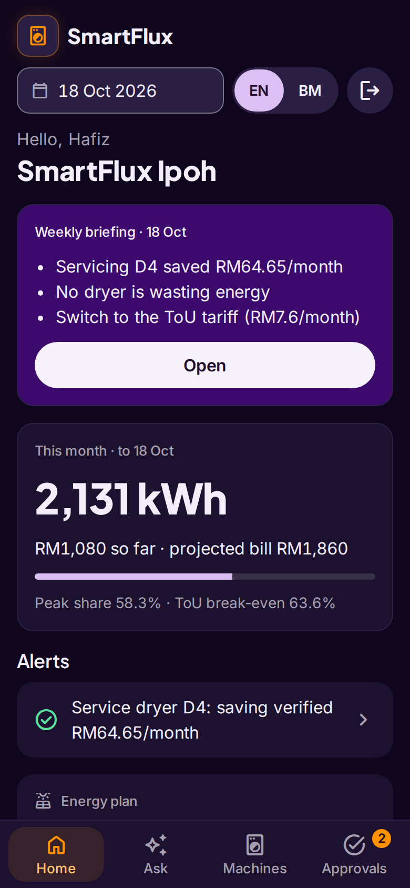
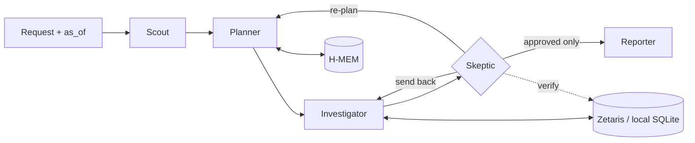

# SmartFlux EDIS

> *"TNB tells you what you spent. SmartFlux tells you what to do about it, and proves it worked."*

An agent that tells a Malaysian laundromat owner whether to install solar, switch tariff or both, finds the machines wasting energy, and proves whether each fix saved money.

**Open Agent Hackathon 2026 · Track 3: Reasoning Architecture**
Built with Zetaris · Meterless H-MEM · Meterless Nightshift · NVIDIA Nemotron · Claude Code

```bash
pnpm install && pnpm agent --input input_examples/06-energy-plan.json   # sample mode: no keys, no services
```

---

## The problem

A self-service laundromat owner sees one number: the monthly TNB bill. They don't know which machine, hour or tariff drives it. Since July 2025 they can opt into the Time-of-Use (ToU) tariff, and since January 2026 they can install rooftop solar under Solar ATAP. These two decisions interact, and installers size solar from the bill, not from when the load actually happens. Meanwhile a dryer with a clogged vent or a weak heater quietly wastes money (RM48–85 a month for the faulty dryers in our sample data) until it breaks, and nobody checks whether a fix worked.

We did not reach a laundromat owner for an interview in the build window, so we quote none. The problem framing rests on public sources: TNB's ToU tariff for non-domestic users, the Solar ATAP scheme, and laundromat owners' own posts about electricity costs.

## What it does

1. **Decides solar, ToU or both, jointly.** It sizes solar from the outlet's half-hourly load and real irradiance, then re-decides the tariff on the grid load that remains. For the example outlet: 10 kWp solar and stay on flat, RM502.75/month. The naive sum of the two separate savings (RM510.35) is rejected, because solar raises the peak share above the ToU break-even.
2. **Finds wasteful machines without sensors.** It regresses meter intervals on the cycle logs the payment system already records. Electric dryers are tracked by kWh per cycle, gas dryers by cycle minutes.
3. **Acts only with approval, then verifies.** After the owner approves a fix, a later session measures the realised saving against the machine's remembered baseline and its peers.
4. **Works unprompted.** A Monday briefing for every outlet, plus Scope 2 emissions figures.



Every RM figure is computed by tested code, never by the LLM, and is re-checked by a Skeptic agent against the data before the owner sees it.

## Agents

| Agent | Model lane | Authority |
| --- | --- | --- |
| Scout | Fast | Classifies intent and risk; refuses out-of-scope requests |
| Planner | Fast | Forms hypotheses from the request and memory; re-plans when nothing survives |
| Investigator | none (tool runner) | Runs query templates through Zetaris and the calculators; never states a number it did not compute |
| **Skeptic** | Deep | Re-queries the data to verify each claim; **can send work back and block the Reporter**; rejects double-counted savings |
| Reporter | Deep | Writes decision cards in English or Malay from approved claims only |



## Quick start

Requires Node 22.13+ and pnpm.

```bash
# Sample mode: no credentials, no sponsor services, the real agent logic on cached data
pnpm install
pnpm agent --input input_examples/06-energy-plan.json     # prints every agent step (JSONL), then the result
pnpm agent --approve <action_id>                          # record the owner's decision in H-MEM
pnpm test                                                 # calculators, H-MEM, agents, live-path fakes
pnpm eval                                                 # objective checks on seeds 1 and 2 → eval/report.md
pnpm benchmark                                            # 30 generated outlets → eval/benchmark.md
pnpm examples                                             # re-run the 8 examples → output_examples/
```

No `.env` is needed for sample mode. On Windows, run it inside WSL2.

### Web app (customer, owner, admin)

```bash
pnpm demo      # builds the web app, then serves it with the API on http://localhost:8000
pnpm dev       # while editing: API on :8000 + Vite with hot reload on http://localhost:5173 (proxies the API)
```

One app, three roles. Accounts are stored in SQLite (`data/users.db`, created on first start) with scrypt-hashed passwords; Google sign-in turns on when `GOOGLE_CLIENT_ID` and `GOOGLE_CLIENT_SECRET` are set (see `.env.example`).

| Role | Sees | Can do |
| --- | --- | --- |
| **Super admin** (the business owner; desktop) | Every outlet: the franchise dashboard (KPIs, peak vs off-peak, flagged machines, advice scoreboard, run log) and the outlet app | Everything an admin can, export Scope 2 CSV, and add, edit or remove people on the People screen |
| **Admin** (a franchise manager; phone) | The outlets they were given: weekly briefing, bill so far, energy plan, decisions with evidence, machines | Ask the agent, approve or reject actions |
| **Customer** (phone) | Outlets with live free machines, each machine as free, in use (a countdown from the real cycle) or under maintenance; owner-approved happy hours | Report a machine that isn't working. Sign up with email or Google, or scan an outlet's QR code (`/customer?outlet=OUT-01`) to look as a guest |

In sample mode a clean clone seeds three demo accounts, all with the password `smartflux-demo` (sample mode only; live mode creates only the super admin you name in `SUPERADMIN_EMAIL` / `SUPERADMIN_PASSWORD`):

| Email | Role |
| --- | --- |
| `owner@smartflux.demo` | Super admin |
| `ipoh@smartflux.demo` | Admin for OUT-01 Ipoh |
| `customer@smartflux.demo` | Customer |

The server re-reads the account and checks its role and outlet on every route (`403` otherwise; a removed account is signed out at once), so a customer can never read energy data or approve anything. Five wrong passwords lock an email for 15 minutes. A machine shows **under maintenance** only after the Skeptic approved the fault and an admin approved the service; a customer report is cited as supporting evidence but never flags a machine on its own. Use the date picker to replay the sessions (13 Sep → 4 Oct → 18 Oct).

### Live mode (Zetaris + Nightshift)

```bash
cp .env.example .env                       # fill in Zetaris, Postgres and Nightshift settings, SAMPLE_MODE=false
docker compose up -d smartflux-pg          # synthetic source data, loaded from data/sample on first start
pnpm zetaris:setup --dry-run               # review: datasource, Open-Meteo REST table, semantic layer
pnpm zetaris:setup                         # create them (add --weather pg if the REST unnest fails)
pnpm smoke                                 # Zetaris checks + template parity, Nightshift lanes
pnpm agent --input input_examples/02-bill-why.json
```

Each side can go live on its own (`DATA_MODE=zetaris` or `LLM_MODE=nightshift`).

`LLM_MODE` picks who reasons. The mode label and every log event name the source.

| `LLM_MODE` | Reasoning | Needs |
| --- | --- | --- |
| `rules` (sample default) | The rules agents only, no LLM | Nothing |
| `nightshift` (live default) | Nemotron through Meterless Nightshift, the primary path | Nightshift runtime URL, token, two pinned routes |
| `nvidia` | Nemotron straight from build.nvidia.com; a backup when Nightshift is unreachable | `NVIDIA_API_KEY` |
| `replay` | Answers recorded from a real Nemotron run (`data/sample/llm-cache/`), offline; every number is still computed. A prompt with no recording uses the rules agent for that step | Nothing |

`LLM_RECORD=true` saves live answers for replay. The recorded live run of all 8 examples is in [output_examples/live-nemotron/](output_examples/live-nemotron/). It was recorded through build.nvidia.com, not Nightshift. If a live service fails mid-run, that step retries, then uses its local twin (SQLite or the rules reasoner), and the run is marked `mixed`.

## Usage

**CLI:** `pnpm agent --input <file>` runs one request; `pnpm agent --briefing --as-of 2026-10-18` runs the Monday briefing; `pnpm agent --approve <action_id>` records the owner's decision.

**HTTP** (`pnpm start`, port 8000): sign in, then ask.

```bash
TOKEN=$(curl -s localhost:8000/login -d '{"email":"owner@smartflux.demo","password":"smartflux-demo"}' | sed -E 's/.*"token":"([^"]+)".*/\1/')
curl -s localhost:8000/run -H "authorization: Bearer $TOKEN" \
  -d '{"outlet_id":"OUT-01","as_of":"2026-10-18","question":"Solar, ToU or both?"}'
curl -s localhost:8000/approve -H "authorization: Bearer $TOKEN" -d '{"action_id":"<id>","decision":"approved"}'
curl -s localhost:8000/runs/<run_id> -H "authorization: Bearer $TOKEN"     # result, every log event, the SQL run
```

**The eight examples** (`input_examples/` → real outputs and logs in `output_examples/`, regenerated by `pnpm examples`):

| # | Request | Outlet, as of | Expected behaviour | Output |
| --- | --- | --- | --- | --- |
| 01 | Should I switch to the ToU tariff? | OUT-01, 18 Oct | Switch: peak share 58.3% is below the 63.6% break-even | Switch to the ToU tariff |
| 02 | Why was my bill higher this month? Should I switch to ToU? | OUT-01, 4 Oct | Finds dryer D4 (+26% kWh per cycle), rules out the humid week | Energy use +2% per day / Switch to ToU / Service dryer D4 |
| 03 | Should I switch to the ToU tariff? | OUT-03, 18 Oct | Stay: peak share 75.1% is above break-even | Stay on your current flat tariff |
| 04 | Mesin mana yang rugi? (Malay) | OUT-02, 18 Oct | Gas dryer G3 found from cycle minutes, no kWh claim, answered in Malay | Servis pengering G3 |
| 05 | Write me a marketing email | OUT-01, 18 Oct | Refused, lists what it can do | I can't help with that… |
| 06 | Solar, ToU or both? | OUT-01, 18 Oct | Joint decision; the summed RM510.35 is sent back by the Skeptic | Install 10 kWp solar, stay on your current tariff |
| 07 | Did servicing D4 work? | OUT-01, 18 Oct | Before vs after, minus peers, ± 2 SE band | Servicing D4 saved RM64.65/month |
| 08 | (Monday briefing) | OUT-01, 18 Oct | Unprompted summary of the week | Weekly briefing, Mon 19 Oct |

## Sponsor technology

| Sponsor | Where | What it does |
| --- | --- | --- |
| **Zetaris** | `apps/backend/src/adapters/zetaris.ts`, `infra/zetaris/` | The only live data path. A Postgres datasource (meter readings, machine cycles, tariffs, service log, solar parameters, holidays) and a live REST table (Open-Meteo weather and radiation) sit behind a semantic layer (`smartflux.energy`) that holds the peak/off-peak/holiday rule once. Every query template, including the Skeptic's verification queries, runs here. The adapter is read-only (SELECT/SHOW/DESCRIBE), sends one statement per call, and binds parameters through a whitelist. |
| **Meterless H-MEM** | `apps/backend/src/engines/hmem/` | Tiered memory with ranked, `as_of`-scoped recall and a JSONL trust ledger (`logs/hmem-ledger.jsonl`). It holds each machine's baseline, every piece of advice, the owner's approvals and rejections, and measured outcomes, so later sessions verify earlier advice. The recall is injected into the Planner's prompt. Tested in `memory.test.ts`. |
| **Meterless Nightshift** | `apps/backend/src/adapters/llm.ts` | The only AI provider: one injected generator (the Meterless engine rule), OpenAI-format, with the `meterless-app` and `meterless-scope` headers. |
| **NVIDIA Nemotron** | via Nightshift lanes | The fast lane runs Scout (intent) and Planner (hypotheses from memory). The deep lane runs Skeptic (causal judgment on causal claims) and Reporter (English and Malay wording). The model is logged on every LLM-backed event. The LLM never computes money, and a rewrite that changes a number is rejected. |
| Intent routing | `apps/backend/src/engines/scout/` | Modelled on Meterless Scout Intent (the engine spec wasn't available): routing plus the approval gate for operational and financial actions. |

## Logs

Every step is one JSON line on stdout and in `logs/<run_id>.jsonl` (fields in [architecture §8](docs/architecture.md)); H-MEM writes its trust ledger to `logs/hmem-ledger.jsonl`. The Skeptic sending a double-counted saving back to the Investigator, from [example 06](output_examples/logs/06-energy-plan.jsonl):

```json
{"run_id":"r-547c2a63","mode":"sample","retry_count":1,"status":"needs_revision","agent_name":"Skeptic","action":"verify",
 "input_summary":"claim c1: Switch to ToU (RM7.60) and add 10 kWp solar (RM502.75): RM510.35/month",
 "output_summary":"Rejected: RM7.60 + RM502.75 = RM510.35 adds two savings that overlap: solar moves the peak share from 58.3% to 64.9%, where ToU costs RM1.39 more; recompute jointly",
 "target_agent":"Investigator"}
```

## Evaluation

```text
$ pnpm test        # calculators, H-MEM, Scout routing + risk gate, agents, live-path fakes, HTTP + roles
ℹ tests 60
ℹ pass 60
ℹ fail 0

$ pnpm eval        # outcomes O1–O11 + log assertions on seed 1 and the held-out seed 2 (report: eval/report.md)
24 checks, 24 pass
```

`pnpm benchmark`: 30 generated outlets (seeds 100–109), 98 runs with fresh memory ([eval/benchmark.md](eval/benchmark.md) lists every miss):

| Metric | Result | Target |
| --- | --- | --- |
| ToU verdicts match the calculator | 30/30 | 100% |
| Joint solar/ToU decision matches the calculators | 30/30 | 100% |
| Fault recall (faults ≥ +20%) | 21/21 | ≥ 90% |
| Faults +15–20% found (below the threshold) | 3/5 | stated limit |
| False fault flags | 0 | ≤ 1 |
| Realised saving within ±15% of planted | 3/4 ❌ | ≥ 90% |
| Runs within caps | 98/98 | 100% |
| Median run time, sample mode | 51 ms | ≤ 5 s |

Two honest misses: one M&V estimate lands just outside the ±15% band (realised 0.62 vs planted 0.53 kWh/cycle), and on seed 1 two of 71 dryer-weeks are 11–14% off in the weekly regression (O2 counts ≥ 95% within ±10%). A single week has only about 40 cycles per dryer; neither miss flags a fault, because `fault_check` needs a multi-week change that peers don't share.

## Failure handling

| Failure | What happens | Logged as |
| --- | --- | --- |
| Zetaris times out or errors | One retry, then the same template runs on local SQLite; the run is marked `mixed` | `retrying`, then `fallback` |
| Nightshift is down | Two retries with backoff, then that role's rules twin; the run is marked `mixed` | `fallback` |
| LLM returns invalid JSON | One repair prompt with the bad reply; if still invalid, the rules twin | `fallback` if the repair fails |
| LLM wording changes a number | That card's rewrite is dropped; the template wording stays | Reporter `llm.word` event says how many were kept |
| Claim fails the Skeptic 3 times | The claim goes to `unresolved`, never into a card | `needs_revision` |
| 30 tool calls or 2 re-plans used | The run stops; open hypotheses are listed in `unresolved` with the cap that stopped them | result `unresolved` |
| Request out of scope | Refused, with the list of what SmartFlux can do | Reporter `refuse` |
| Operational or financial action | Never auto-runs: `awaiting_approval` until the owner decides | action `status` in the result |
| Live mode with a missing variable | Startup fails naming the variable, and suggests `SAMPLE_MODE=true` | — |
| Non-read SQL reaches the adapter | Rejected before sending (SELECT/SHOW/DESCRIBE only, one statement) | adapter error |

## Docs

| Doc | What it is |
| --- | --- |
| [docs/proposal.md](docs/proposal.md) | The full idea, maths, demo script, rubric mapping |
| [docs/prd.md](docs/prd.md) | Personas, user stories, requirements, scope |
| [docs/architecture.md](docs/architecture.md) | C4 views, runtime flows, decision records |
| [docs/implementation.md](docs/implementation.md) | Stack, repo layout, build order |
| [docs/data-and-evaluation.md](docs/data-and-evaluation.md) | Data window, generator, planted facts, benchmark |
| [docs/design-system.md](docs/design-system.md) | Tokens, components, accessibility |
| [docs/features.md](docs/features.md) | Screen-by-screen features for the Owner app and Admin web |
| [docs/judges-validation.md](docs/judges-validation.md) | Mock-panel gates, rubric and questions |
| [docs/submission-pack.md](docs/submission-pack.md) | Form answers, deck outline, sponsor write-up |
| [docs/user-research.md](docs/user-research.md) | Owner interview plan (English and Malay) |

## Data and limitations

- All business data (meters, cycles, machines) is **synthetic** and labelled as such. Weather comes from [Open-Meteo](https://open-meteo.com/) (CC BY 4.0) and holidays from the public Malaysia holiday calendar. Both are real.
- Solar figures depend on stored assumptions: cost per kWp, derate, and exports valued at zero.
- Tariff rates must be confirmed against TNB's official non-domestic schedule.
- Machine attribution needs machines that don't always run together; collinear machines are merged and reported as one.
- Gas-dryer fuel cost is an estimate from cycle minutes, not metered.
- The post-service recovery in the demo is planted, because the demo cannot wait weeks.
- Faults below +20% kWh per cycle are reported only when found, not counted as misses (see the benchmark).

## Pre-existing work

A UI prototype (pnpm monorepo, Express 5, React 18 + Vite) existed before the build window; see [PRE_EXISTING.md](PRE_EXISTING.md). None of it is reused: everything in this repository was written in the window.

## Team

| Person | Built |
| --- | --- |
| Sharvin | Data generator, Zetaris setup and adapter, query templates, calculators and tests |
| Nuruddin | Orchestrator, agents (LLM and rules), Nightshift adapter, H-MEM, intent routing, logs |
| Dina | Owner app, Admin web, demo video, slide deck |
| Jatul | Admin web scope, user research, README and sponsor write-up |

## License

[MIT](LICENSE). Third-party data keeps its own licence (see above).
