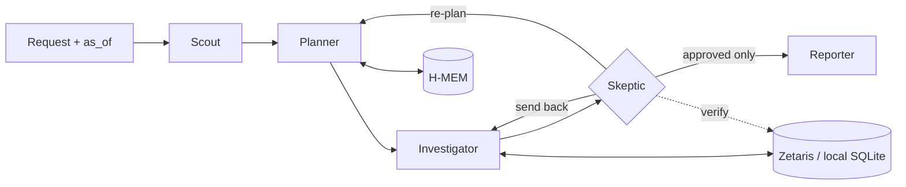

# SmartFlux EDIS

> *"TNB tells you what you spent. SmartFlux tells you what to do about it, and proves it worked."*

An agent that tells a Malaysian laundromat owner whether to install solar, switch tariff or both, finds the machines wasting energy, and proves whether each fix saved money.

**Open Agent Hackathon 2026 · Track 3: Reasoning Architecture**
Built with Zetaris · Meterless H-MEM · Meterless Nightshift · NVIDIA Nemotron · Claude Code

> **Status: in development.** This repo currently holds the design docs only. Commands below describe the planned interface and will work once the code lands. See [TODO.md](TODO.md) for progress.

---

## The problem

A self-service laundromat owner sees one number: the monthly TNB bill. They don't know which machine, hour or tariff drives it. Since July 2025 they can opt into the Time-of-Use (ToU) tariff, and since January 2026 they can install rooftop solar under Solar ATAP. These two decisions interact, and installers size solar from the bill, not from when the load actually happens. Meanwhile a dryer with a clogged vent or a weak heater can waste about RM180 a month without anyone noticing, and nobody checks whether a fix worked.

## What it does

1. **Decides solar, ToU or both, jointly.** It sizes solar from the outlet's half-hourly load and real irradiance, then re-decides the tariff on the grid load that remains. For the example outlet: 10 kWp solar and stay on flat, about RM507/month.
2. **Finds wasteful machines without sensors.** It regresses meter intervals on the cycle logs the payment system already records. Electric dryers are tracked by kWh per cycle, gas dryers by cycle minutes.
3. **Acts only with approval, then verifies.** After the owner approves a fix, a later session measures the realised saving against the machine's remembered baseline and its peers.
4. **Works unprompted.** A Monday briefing for every outlet, plus Scope 2 emissions figures.

Every RM figure is computed by tested code, never by the LLM, and is re-checked by a Skeptic agent against the data before the owner sees it.

## Agents

| Agent | Model lane | Authority |
| --- | --- | --- |
| Scout | Fast | Classifies intent and risk; refuses out-of-scope requests |
| Planner | Fast | Forms hypotheses from the request and memory; re-plans when nothing survives |
| Investigator | Fast | Runs query templates and calculators; never states a number it did not compute |
| **Skeptic** | Deep | Re-queries the data to verify each claim; **can send work back and block the Reporter**; rejects double-counted savings |
| Reporter | Deep | Writes decision cards in English or Malay from approved claims only |



## Quick start (planned)

Requires Node 22.13+ and pnpm.

```bash
# Sample mode: no credentials, no sponsor services, real agent logic on cached data
cp .env.example .env        # leave SAMPLE_MODE=true
pnpm install
pnpm agent --input input_examples/06-energy-plan.json
pnpm dev                    # API on :8000, web app on :5173

# Or Docker
docker compose up --build
curl -X POST http://localhost:8000/run -H "Content-Type: application/json" \
  -d @input_examples/02-bill-why.json
```

Live mode needs Zetaris (Docker) and Meterless Nightshift running. See [docs/proposal.md §10](docs/proposal.md#10-data-layer-zetaris) and [§17.3](docs/proposal.md#173-nightshift-and-nemotron).

## Sponsor technology

| Sponsor | Role |
| --- | --- |
| **Zetaris** | The only live data path: a Postgres datasource and two live REST tables (Nager.Date holidays, Open-Meteo weather), with a semantic layer the query templates read. The Skeptic verifies claims through it |
| **Meterless H-MEM** | Remembers machine baselines, advice, approvals and outcomes across restarts |
| **Intent routing** (modelled on Meterless Scout Intent; the engine spec wasn't available) | Routes requests by intent and gates operational and financial actions behind owner approval |
| **Meterless Nightshift → NVIDIA Nemotron** | The only LLM provider: Nemotron Lightning (fast lane) and Nemotron Super (deep lane), logged on every call |

## Docs

| Doc | What it is |
| --- | --- |
| [docs/proposal.md](docs/proposal.md) | The full idea, maths, demo script, rubric mapping |
| [docs/prd.md](docs/prd.md) | Personas, user stories, requirements, scope |
| [docs/architecture.md](docs/architecture.md) | C4 views, runtime flows, decision records |
| [docs/implementation.md](docs/implementation.md) | Stack, repo layout, build order |
| [docs/data-and-evaluation.md](docs/data-and-evaluation.md) | Data window, generator, planted facts, benchmark |
| [docs/design-system.md](docs/design-system.md) | Tokens, components, accessibility |
| [docs/features.md](docs/features.md) | Screen-by-screen features for the Owner app and Admin web |
| [docs/judges-validation.md](docs/judges-validation.md) | Mock-panel gates, rubric and questions |
| [docs/submission-pack.md](docs/submission-pack.md) | Form answers, deck outline, sponsor write-up |
| [docs/user-research.md](docs/user-research.md) | Owner interview plan (English and Malay) |

## Data and limitations

- All business data (meters, cycles, machines) is **synthetic** and labelled as such. Weather comes from [Open-Meteo](https://open-meteo.com/) (CC BY 4.0) and holidays from [Nager.Date](https://date.nager.at/) (MIT). Both are real.
- Solar figures depend on stored assumptions: cost per kWp, derate, and exports valued at zero.
- Tariff rates must be confirmed against TNB's official non-domestic schedule.
- The post-service recovery in the demo is planted, because the demo cannot wait weeks.

## Pre-existing work

A UI prototype (pnpm monorepo, Express 5, React 18 + Vite) existed before the build window and will be declared in `PRE_EXISTING.md`. The agent core is new work.

## License

[MIT](LICENSE). Third-party data keeps its own licence (see above).
