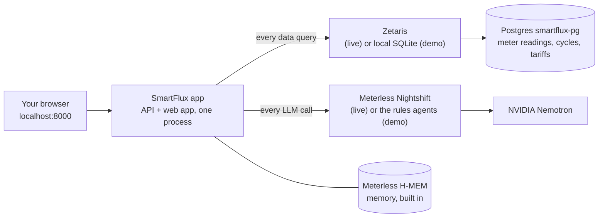

# SmartFlux EDIS for Dummies

How to start SmartFlux, from nothing to a running app, in plain steps. If you only want to see it working, do **Path A**. It takes about five minutes and needs no accounts, keys or Docker.

| Path | You get | You need | One command |
| --- | --- | --- | --- |
| **A. Demo** | The whole app on sample data; the real agents, no LLM | Node and pnpm | `pnpm demo` |
| **B. Editing** | Path A with hot reload while you change the code | Node and pnpm | `pnpm dev` |
| **C. Live** | Data through Zetaris, reasoning by NVIDIA Nemotron through Meterless Nightshift | Docker, a Zetaris account, Nightshift, an NVIDIA key | `pnpm live` (after a one-time setup) |

---

## 1. What the pieces are



| Piece | What it is | Do I start it? |
| --- | --- | --- |
| **SmartFlux app** | This repo: the five agents (Scout, Planner, Investigator, Skeptic, Reporter), the API on port 8000 and the web app | Yes: `pnpm demo` |
| **Local SQLite** | A copy of the sample data in `data/sample/`, used in demo mode | No, it's a file |
| **Meterless H-MEM** | The agents' memory (each machine's normal level, advice, your approvals, measured outcomes). Code inside SmartFlux, stored in `data/hmem/` | No, it's built in |
| **Postgres (`smartflux-pg`)** | The database Zetaris reads in live mode, loaded from `data/sample` on first start | Live only: Docker starts it |
| **Zetaris** | The live data platform. The agents send their SQL here | Live only: its own Docker setup (section 5) |
| **Meterless Nightshift** | A desktop app that is the AI gateway: SmartFlux sends every LLM call to it, and it forwards them to Nemotron | Live only: you open the app (section 6) |
| **NVIDIA Nemotron** | The language model. It helps classify questions, plan and word answers. It never computes money | No: Nightshift reaches it |

"Meterless" is the sponsor's name for two different things: **H-MEM** (memory, built in, nothing to start) and **Nightshift** (the AI gateway app, only for live mode).

---

## 2. Install once

1. **Node 22.13 or newer.** Check with `node -v`. Get it from nodejs.org or with `nvm install 22`.
2. **pnpm.** Run `corepack enable`. It comes with Node.
3. **The code.** Clone the repo, open a terminal in it and run:

   ```bash
   pnpm install
   ```

On Windows, do all of this inside **WSL2** (Ubuntu), not in PowerShell.

---

## 3. Path A: the demo, one command

```bash
pnpm demo
```

This builds the web app, then starts the API and the web app together on **http://localhost:8000**. Leave the terminal open, and press `Ctrl+C` to stop.

Open http://localhost:8000. You land on the SmartFlux page. Press **Get started**, then pick a role. The demo needs no password.

| Role | Who they are | Where they land |
| --- | --- | --- |
| **Super admin** | The business owner | **HQ**: the web console with every outlet, a sidebar of pages and the People screen |
| **Admin** | The Ipoh franchise manager | **Outlet app**: briefing, ask the agent, approvals, machines (made for a phone) |
| **Customer** | Someone doing laundry | **Customer app**: free machines and happy hours. It's phone-only, so on a laptop press "Preview it here" |

### A five-minute tour that shows the whole idea

The sample data covers 7 Sep to 18 Oct 2026. Dryer D4 at Ipoh starts wasting energy in week 4. Use the **date picker** at the top to move through time.

1. **Find the fault.** Sign in as **Admin**. Set the date to **4 Oct**. Tap **Ask** and type `Which machine is wasting money?`. You get *Service dryer D4*, with the evidence and the data checked.
2. **Approve it.** Open **Approvals** and approve the D4 service.
3. **See what customers see.** Sign out, then pick **Customer** (on a laptop, press "Preview it here"). With the date on 4 Oct, D4 shows **under maintenance**. Nothing reaches customers until the owner approves.
4. **Prove it worked.** Back as **Admin**, set the date to **18 Oct** and ask `Did servicing D4 work?`. You get *Servicing D4 saved RM64.65/month*, measured against D4's own normal level and the other dryers.
5. **See the business.** Sign out and pick **Super admin**. HQ shows every outlet:
   - **Agent interventions:** what the agent advised, what you decided, what was verified.
   - **Data and AI:** how many queries went to SQLite or Zetaris, how many LLM calls, how often the Skeptic sent work back.
   - **Audit log:** who did what, and when.
6. **Watch the Skeptic say no.** As Admin on 18 Oct, ask `Solar, ToU or both?`. Then open **Evidence** on the answer. The Skeptic rejected the naive RM510.35 sum and sent it back. The final answer is 10 kWp solar and stay on the flat tariff, RM502.75/month.

**Start again from a clean slate.** Stop the server and delete what the demo wrote:

```bash
rm -rf data/hmem logs data/users.db
```

### Without the web app (terminal only)

```bash
pnpm agent --input input_examples/06-energy-plan.json   # one question, every agent step printed
pnpm test                                               # 60 tests
pnpm eval                                               # 24 checks on two data seeds
```

---

## 4. Path B: editing the code

```bash
pnpm dev
```

This starts two things at once:
- the API on :8000, which restarts by itself when you save a backend file;
- Vite on **http://localhost:5173**, with hot reload.

Open :5173. Vite forwards API calls to :8000.

---

## 5. Path C, part 1: Zetaris (live data)

You do this once. It needs Docker Engine 25+ with 8 GB RAM, 4 CPUs and 15 GB of free disk.

1. **Get Zetaris.** Sign up at zetaris.com/cloud. Download `zetaris-platform.zip` and its `.env`, then unzip it in a folder **outside** this repo.
2. **Start Zetaris,** in that folder:

   ```bash
   docker login zetarishackathon.azurecr.io
   ./preflight.sh
   # edit its .env: admin email, a strong password, UI_PORT=3000
   docker compose pull && docker compose up -d
   ./verify.sh                       # expect 9/9 pass
   ```

   The Zetaris UI is now at http://localhost:3000, and its REST API at http://localhost:8888.
3. **Make your SmartFlux settings file,** back in this repo:

   ```bash
   cp .env.example .env
   ```

   In `.env`, set `PGPASSWORD` to any password you like.
4. **Start the source database** that Zetaris will read:

   ```bash
   docker compose up -d smartflux-pg
   ```

   On first start it loads the sample data from `data/sample/`.
5. **Get an API key.** In the Zetaris UI, create an API key. Put it in `.env` as `ZETARIS_API_KEY`, with `ZETARIS_ORG_ID` and the URLs:

   ```bash
   ZETARIS_REST_URL=http://localhost:8888/api/v1.0
   ZETARIS_BASE_URL=http://localhost:3000
   ```

6. **Create SmartFlux's tables in Zetaris.** This makes the datasource, the weather table and the semantic layer:

   ```bash
   pnpm zetaris:setup --dry-run      # prints every statement, sends nothing
   pnpm zetaris:setup                # creates them (add --weather pg if the REST weather step fails)
   ```

7. **Check it:**

   ```bash
   pnpm smoke --zetaris
   ```

   You should see "All checks passed". This includes a parity test: each query on Zetaris must match its SQLite twin row for row.

## 6. Path C, part 2: Meterless Nightshift (live AI)

Nightshift is a desktop app. On Windows it runs on Windows itself, not in WSL.

1. Install Nightshift from meterless.ai and open it.
2. Get an NVIDIA API key at build.nvidia.com: open a Nemotron model, then **Get API Key**.
3. In Nightshift, go to **Setup → Providers → NVIDIA** and paste the key. The key lives in Nightshift, never in SmartFlux's `.env`.
4. In **NIGHT → LANES**, set lane 1 to Nemotron Lightning (fast) and lane 2 to Nemotron Super (deep).
5. From **Console**, copy the **Runtime URL** and **token** into `.env`:

   ```bash
   METERLESS_BASE_URL=http://127.0.0.1:8088/v1
   METERLESS_RUNTIME_TOKEN=...
   ```

6. Fill in the model routes. Open `<METERLESS_BASE_URL>/models` and copy the two pinned Nemotron route names into `MODEL_FAST` and `MODEL_DEEP`.
7. Check it:

   ```bash
   pnpm smoke --nightshift
   ```

   Each lane should answer.

**WSL users:** from WSL, `127.0.0.1` may not reach Nightshift on Windows. Use the Windows host IP in `METERLESS_BASE_URL`, or turn on mirrored networking in `.wslconfig`.

**No Nightshift?** As a backup, use NVIDIA directly:
- In `.env`, set `LLM_MODE=nvidia` and `NVIDIA_API_KEY=...`.
- The logs and the HQ say "build.nvidia.com", so nobody mistakes it for Nightshift.

## 7. Path C, part 3: everything live, one command

Set `SAMPLE_MODE=false` in `.env`. Then, with Zetaris and Nightshift already running:

```bash
pnpm live
```

That one command does three things in order, and stops at the first failure:
1. starts `smartflux-pg` and waits until it is healthy;
2. runs `pnpm smoke` (Zetaris and Nightshift checks);
3. runs `pnpm demo` (build and serve on :8000).

**How to tell it's really live.** Sign in as **Super admin**:
- The strip under the header reads **Data Zetaris · Reasoning nightshift**.
- **Data and AI** counts Zetaris queries and LLM calls going up as you ask questions.
- Each run in the run log shows **Live** instead of **Sample**.

**Half live is fine.** Leave `SAMPLE_MODE=true` and switch on one side only:
- `DATA_MODE=zetaris` for live data;
- `LLM_MODE=nightshift` for live reasoning.

If a live service fails mid-run, SmartFlux retries once and then uses its local twin. The run is then marked **Mixed**.

**Record once, replay anywhere:**
- `LLM_RECORD=true` saves every live answer.
- Later, `LLM_MODE=replay` plays them back with no network.

## 8. Docker instead of Node

```bash
docker compose up app        # the app on :8000, demo mode unless .env says otherwise
```

---

## 9. Cheat sheet

| I want to… | Run |
| --- | --- |
| See the app | `pnpm demo`, then open http://localhost:8000 |
| Edit with hot reload | `pnpm dev`, then open http://localhost:5173 |
| Run everything live | `pnpm live` (after sections 5 and 6) |
| Ask one question in the terminal | `pnpm agent --input input_examples/02-bill-why.json` |
| Run the Monday briefing | `pnpm agent --briefing --as-of 2026-10-18` |
| Run the tests / checks / benchmark | `pnpm test` / `pnpm eval` / `pnpm benchmark` |
| Regenerate the 8 example outputs | `pnpm examples` |
| Check Zetaris and Nightshift | `pnpm smoke` |
| Reset the demo | `rm -rf data/hmem logs data/users.db` |

## 10. When something goes wrong

| You see | Do this |
| --- | --- |
| `Port 8000 is already in use` | Another SmartFlux is running. Stop it with `Ctrl+C` in its terminal, or run `PORT=8001 pnpm demo` |
| `Live mode needs ZETARIS_API_KEY, …` | A live setting is missing from `.env`. Fill it in, or set `SAMPLE_MODE=true` |
| `set PGPASSWORD in .env` | Docker needs `PGPASSWORD` in `.env` before `smartflux-pg` can start |
| `pnpm smoke` fails on Nightshift from WSL | Use the Windows host IP in `METERLESS_BASE_URL` (section 6) |
| Runs are marked **Mixed** | A live service failed and the local twin answered. Look at **Data and AI → Sent back, retried, fell back** |
| Machines show "not learned yet" | Memory is empty. As Admin, ask `Which machine is wasting money?` (tour step 1) and the agents learn each machine's normal level |
| The customer app says "Open SmartFlux on your phone" | It's phone-only. Use a phone, the browser's device mode (F12, then the phone icon), or press "Preview it here" |
| Google sign-in button missing | Optional. Set `GOOGLE_CLIENT_ID` and `GOOGLE_CLIENT_SECRET` (see `.env.example`) |
