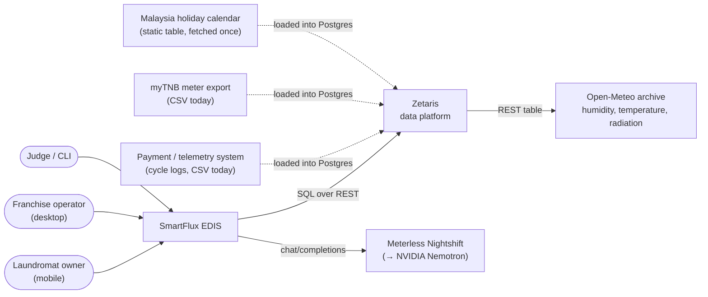
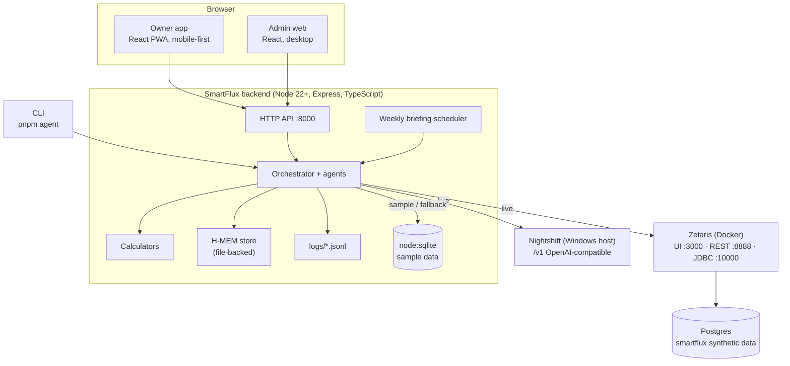
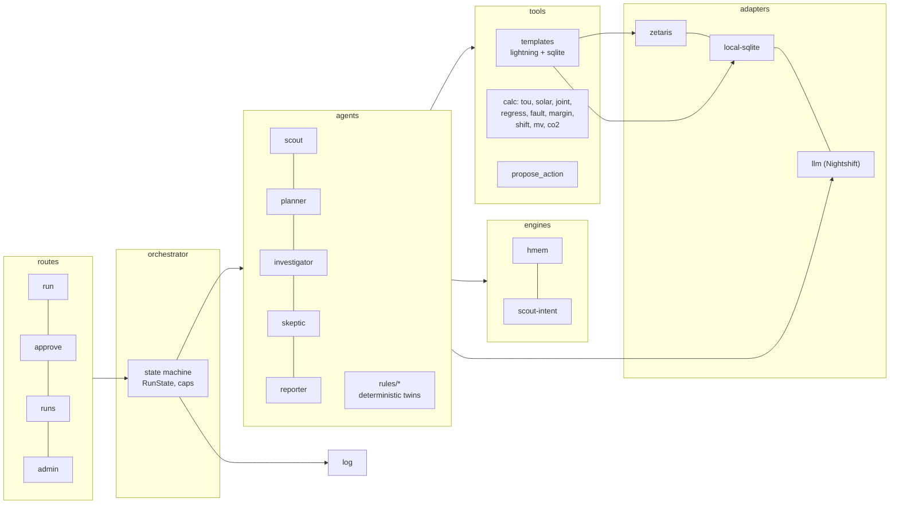
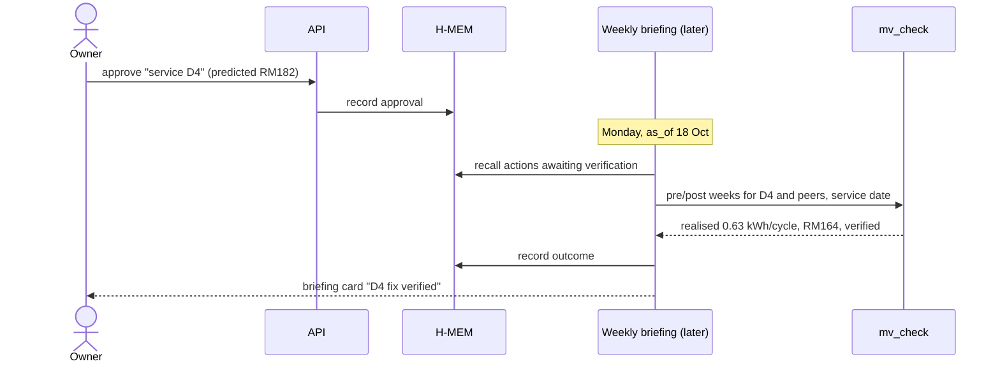

# SmartFlux EDIS: Architecture

| | |
| --- | --- |
| Version | 1.0, matching [proposal v4](proposal.md) and [PRD v1.0](prd.md) |
| Date | 24 Oct 2026 |
| Format | A short arc42-style document with C4 diagrams (context, containers, components) and decision records |

---

## 1. Goals and quality priorities

| Priority | Quality | What it means here |
| --- | --- | --- |
| 1 | **Correctness of money claims** | All RM figures come from tested code; the Skeptic verifies every claim against the data |
| 2 | **Runs anywhere** | Sample mode runs the full logic with no credentials; Docker and a clean clone work |
| 3 | **Explainability** | Every step logged as JSONL; the Evidence screen is rendered from the same log |
| 4 | **Bounded and resilient** | Capped loops, timeouts, retries and per-adapter fallbacks |
| 5 | **Sponsor tech load-bearing** | Zetaris is the only live data path; Nightshift the only LLM path; H-MEM and Scout Intent power features |

## 2. Constraints

| Constraint | Source |
| --- | --- |
| Zetaris integrated with a real role; at least one Meterless Engine in a working feature; Meterless Nightshift as primary AI provider; any AI coding tool (Cursor optional) | Official rules |
| No committed secrets; `.env.example` only | Official rules |
| Sample mode must run real logic, never replay outputs | Disqualification checklist §7–8 |
| No local GPU; NVIDIA models reached through Nightshift's hosted endpoints | Technical execution guide §4 |
| Zetaris needs Docker with 8 GB RAM and 4 CPUs; images are amd64 | Zetaris install guide |
| Nightshift runs on the Windows host; the team develops in WSL2 | Team environment |
| Existing prototype: pnpm monorepo, Express 5 + TypeScript, React 18 + Vite (declared as pre-existing) | Team |

## 3. System context (C4 level 1)



For the hackathon, payment and meter data are synthetic and loaded into Postgres by script; in production they arrive by CSV upload or provider integration.

## 4. Solution strategy

| Problem | Strategy |
| --- | --- |
| LLMs are unreliable at arithmetic | LLMs choose, sequence and explain; deterministic calculators compute every number |
| LLM-written SQL fails in an unfamiliar dialect | Named query templates over the Zetaris semantic layer (USL); free SQL is guarded and logged as an exception |
| "Agents" that are a chain score low | A state machine with two feedback loops (Skeptic → Investigator, Skeptic → Planner) and a hard block (Skeptic → Reporter) |
| Judges may lack credentials | Every external dependency sits behind an adapter with a local implementation; sample mode swaps all of them |
| Decisions interact (solar changes ToU) | A `joint_decision` calculator evaluates combinations on one post-action load; the Skeptic rejects summed savings |
| Advice may be wrong | Measurement and verification against memory and a peer control group |

## 5. Containers (C4 level 2)



| Container | Technology | Responsibility |
| --- | --- | --- |
| Owner app | React 18, Vite, PWA manifest | Briefings, ask, decisions, evidence, approvals, machines, energy plan |
| Admin web | React 18 (same app, `/admin` routes) | All-outlet overview, scoreboard, run log, Scope 2 export |
| Backend | Node 22.13+, Express 5, TypeScript | API, orchestration, agents, calculators, adapters, logs, scheduler |
| H-MEM store | JSON files in `data/hmem/` | Persistent memory across restarts |
| Sample DB | `node:sqlite` over `data/sample/*.csv` | Sample mode and fallback data path |
| Postgres | Docker `postgres:16` | Synthetic source data for Zetaris |
| Zetaris | Vendor Docker stack | Federates Postgres + REST tables; USL model |
| Nightshift | Vendor desktop app | Routes LLM calls to Nemotron lanes |

## 6. Components (C4 level 3: backend)



| Component | Interface (summary) |
| --- | --- |
| `orchestrator/run.ts` | `run(req: RunRequest): Promise<RunResult>`; owns `RunState`, enforces caps, emits log events |
| `agents/<role>.ts` | `(state: RunState, ctx: Ctx) => Promise<Patch>`; one LLM-backed and one `rules/` implementation per role, chosen by `ctx.mode.llm` |
| `engines/hmem` | `recall(outletId, asOf)`, `write(item)`, `recordOutcome(actionId, result)` |
| `engines/scout` | `classify(text, lang) → {intents, risk}`; `gate(action) → "auto" | "await_approval"` |
| `templates/index.ts` | `query(name, params) → Rows`; each template has `lightning` and `sqlite` SQL |
| `calc/*.ts` | Pure functions with unit tests; no I/O |
| `adapters/zetaris.ts` | `runSql(sql)`, 30 s timeout, 1 retry, throws typed errors |
| `adapters/llm.ts` | OpenAI client on `METERLESS_BASE_URL`; `chat(role, messages, tools)`; logs model and run id |
| `log.ts` | `emit(event: LogEvent)` → stdout + `logs/<run_id>.jsonl` |

## 7. Runtime views

### 7.1 Owner question (live)

See [proposal §9.3](proposal.md#93-one-request-through-every-layer) for the full sequence. In short: Scout → H-MEM recall → Planner → Investigator (templates via Zetaris, calculators) → Skeptic (verification query, approve or send back) → Reporter → H-MEM write → approval gate.

### 7.2 Joint energy decision

```mermaid
sequenceDiagram
    participant P as Planner
    participant I as Investigator
    participant Z as Zetaris
    participant C as Calculators
    participant S as Skeptic
    P->>I: hypotheses: solar sizes, ToU grid-only, ToU post-solar
    I->>Z: solar_inputs (load + radiation + solar_params)
    I->>C: solar_calc → options, post-solar load
    I->>C: tou_calc(grid-only), tou_calc(post-solar)
    I->>S: claims: "ToU saves RM14", "10 kWp saves RM507", "total RM521"
    S->>Z: tou_split on post-solar profile (verification)
    S-->>I: reject "total RM521": interacting decisions; recompute jointly
    I->>C: joint_decision → solar + flat RM506.80
    I->>S: resubmit
    S-->>P: approve; ToU after solar = stay
```

### 7.3 Approval and verification



### 7.4 Fallback

A Zetaris call that times out is retried once with a narrower window, then the same template runs on local SQLite; an LLM call that fails twice is handed to the role's rules twin. Both are logged with `status: "fallback"` and the run's `mode` becomes `mixed`.

## 8. Data view

Entity model, sources and Zetaris objects: [proposal §10](proposal.md#10-data-layer-zetaris). Generation, plants and benchmark: [data-and-evaluation.md](data-and-evaluation.md).

Key run-time types:

```ts
type RunRequest = { outlet_id: string; as_of: string; question?: string; lang?: "en" | "ms"; briefing?: boolean };

type LogEvent = {
  ts: string; run_id: string; agent_name: string; action: string;
  input_summary: string; output_summary: string; target_agent?: string;
  confidence?: number; retry_count: number;
  status: "success" | "needs_revision" | "retrying" | "fallback" | "partial_success" | "error";
  model?: string; mode: "live" | "sample" | "mixed"; ms?: number;
};

// Action names: `<source>.query` for data (`zetaris.query` live, `sqlite.query` sample or fallback),
// `calc.<name>` for calculators, and the agent's own verb (`classify`, `plan`, `verify`, `approve`, `report`, `refuse`)
// for agent steps. LLM-backed steps carry `model`; there is no separate `llm.call` event.

type Decision = {
  type: "energy_plan" | "tariff" | "machine_fault" | "verification" | "load_shift" | "esg";
  verdict: string; rm_per_month?: number; confidence: "high" | "medium" | "low";
  evidence: string[]; ruled_out: string[]; assumptions: string[];
};
```

## 9. Deployment view

| Environment | Layout |
| --- | --- |
| Team laptop (live) | WSL2: backend + frontend (`pnpm dev`) or `docker compose up` (app + Postgres). Zetaris stack in Docker. Nightshift on the Windows host, reached via mirrored networking or `host.docker.internal` |
| Judge machine (sample) | `docker compose up` or `pnpm dev` with `SAMPLE_MODE=true`; nothing else |
| Demo recording | Live mode on one team laptop; one segment in sample mode |

Ports: app API 8000, web 5173 (dev) or served by the API in Docker, Zetaris UI 3000 / REST 8888 / JDBC 10000, Nightshift 8088.

## 10. Cross-cutting concepts

| Concept | Approach |
| --- | --- |
| Logging | One `emit()`; JSONL per run; stdout; the UI reads logs, never a separate store |
| Errors | Typed adapter errors → retry → fallback → structured error in the output; never a hang |
| Security | Read-only SQL guard (SELECT/SHOW/DESCRIBE only, USL namespace only); secrets from env; no secrets in logs; NVIDIA key stays in Nightshift |
| Time | Everything evaluated at `as_of`; the clock is never read inside agents |
| Language | Scout detects English or Malay; Reporter writes in the request language; numbers are never translated by the LLM |
| Assumptions | Stored as data (`solar_params`, `tariffs`, `emission_factors`); every card lists the ones it used |
| Accessibility | [design-system.md](design-system.md) tokens meet WCAG 2.2 AA; status always has text and icon, never colour alone |

## 11. Architecture decision records

| ADR | Decision | Alternatives | Why |
| --- | --- | --- | --- |
| 001 | TypeScript end to end, extending the existing monorepo | Python agent service | One language, reuses the declared prototype; Meterless engine guides show TypeScript |
| 002 | Own state machine instead of LangGraph or another framework | LangGraph, CrewAI | Few roles, explicit caps and logs; no extra framework for judges to install; LangGraph is not a sponsor technology |
| 003 | Query templates over a USL model | Free LLM SQL | Predictable runs; Lightning SQL quirks; templates double as verification queries |
| 004 | `node:sqlite` for sample mode | DuckDB, in-memory arrays | Built into Node 22.13+, no dependency; same SQL shape as live |
| 005 | Rules twin per agent role | Replaying recorded runs | Rules forbid replay; twins make sample mode real and give a fallback |
| 006 | Fixed historic data window (7 Sep – 18 Oct 2026) | Rolling "last 31 days" | Same rows for judges and team; the live weather supports the planted story |
| 007 | Exports valued at zero in solar maths by default | Assume an export rate | Credit terms vary; conservative figure; export share shown so oversizing is visible |
| 008 | Weekly regression and peer-controlled M&V | One fit over all data; before/after only | Sees fault onset; cancels weather and traffic |
| 009 | Dark theme only for the hackathon | Light and dark | Matches the design system; light theme on the roadmap |
| 010 | One React app with owner and admin routes | Two apps | Shared components and tokens; one build |

## 12. Technical risks and debt

| Item | Note |
| --- | --- |
| Zetaris SQL REST path undocumented | Smoke test fetches `/redoc/docs.yaml`; proxy route and JDBC as fallbacks |
| Template parity between Lightning SQL and SQLite | Parity test on sample data for every template |
| Scout Intent spec not in the resource pack | Fallback in force (24 Oct): plain intent routing and risk gating; H-MEM carries the Build rule |
| File-backed H-MEM | Fine for a single process; a database would be needed for multi-instance |
| Scheduler in-process | Fine for the demo; production would use a job runner |

## Sources

Structure follows arc42 (goals, constraints, context, solution strategy, building blocks, runtime, deployment, cross-cutting concepts, decisions, risks) with C4 diagrams and ADRs ([arc42 overview](https://dev.to/arc42/brief-introduction-to-arc42-1c0l), [arc42 decisions chapter](https://arc42-template.atlassian.net/wiki/spaces/7SE/pages/1637038/9.+Design+Decisions), [comparison of documentation models](https://dev.to/adityasatrio/comparing-software-architecture-documentation-models-and-when-to-use-them-495n)).
