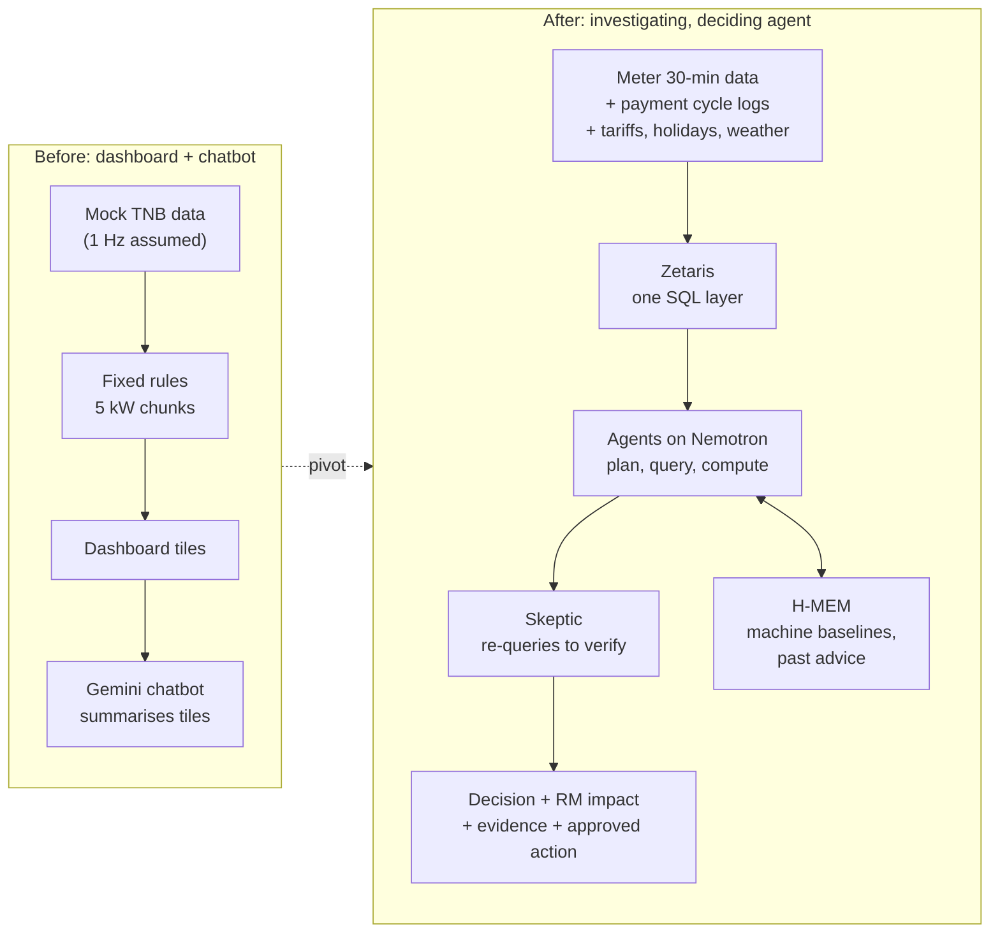
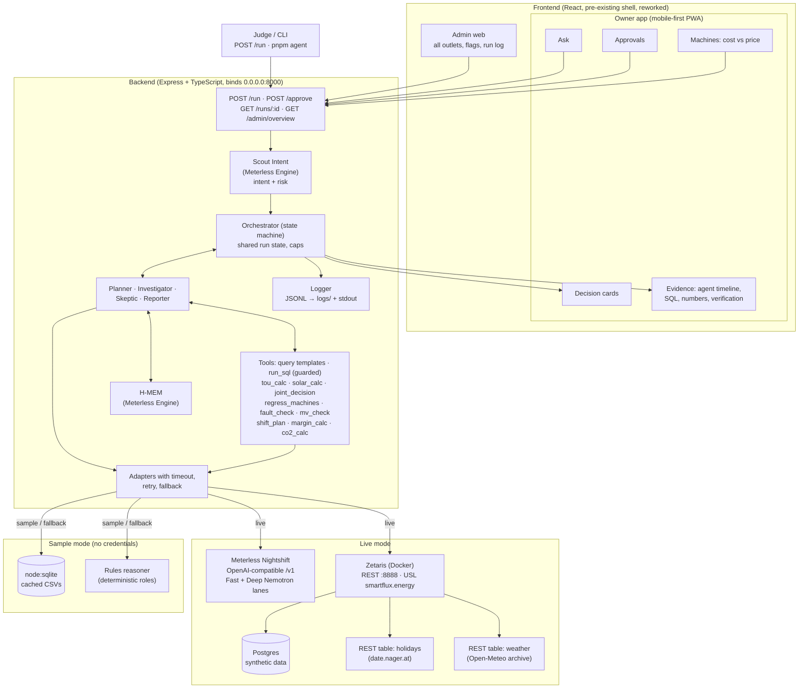
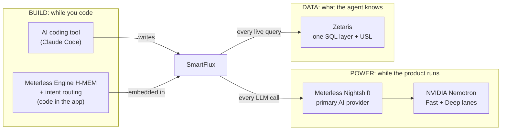
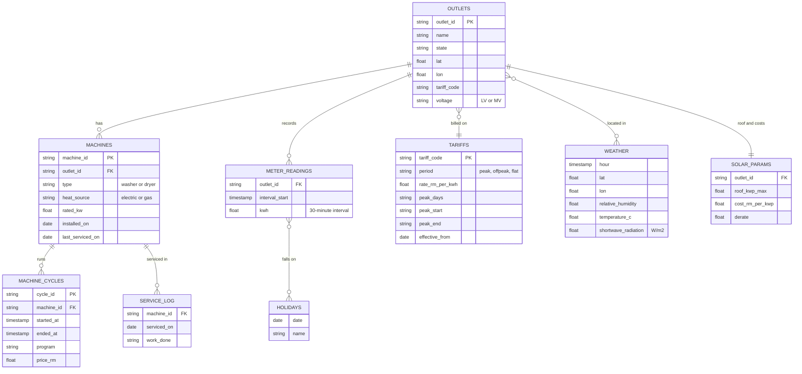
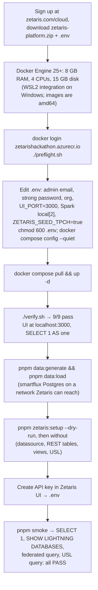
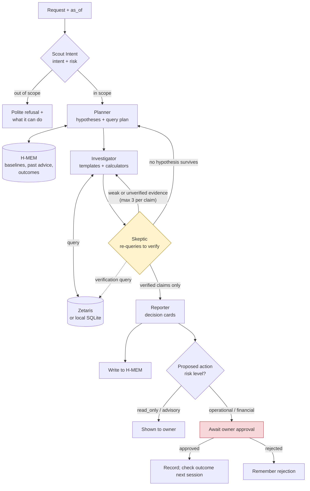
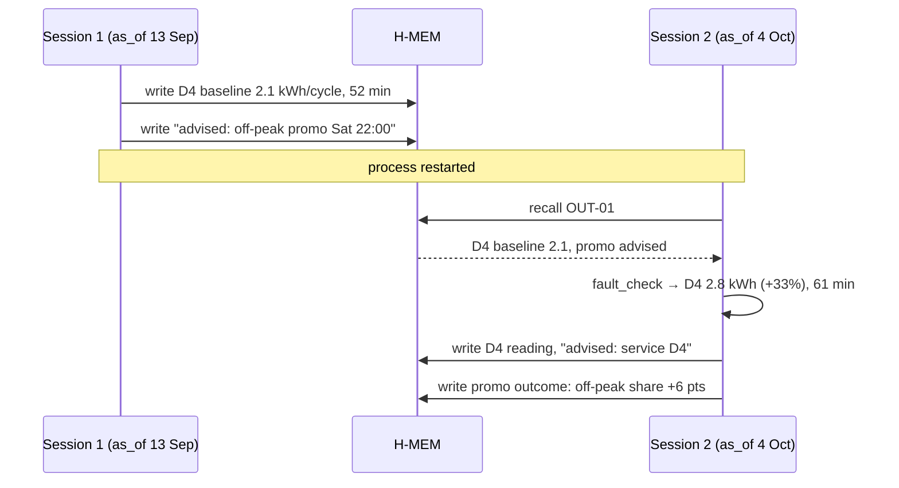
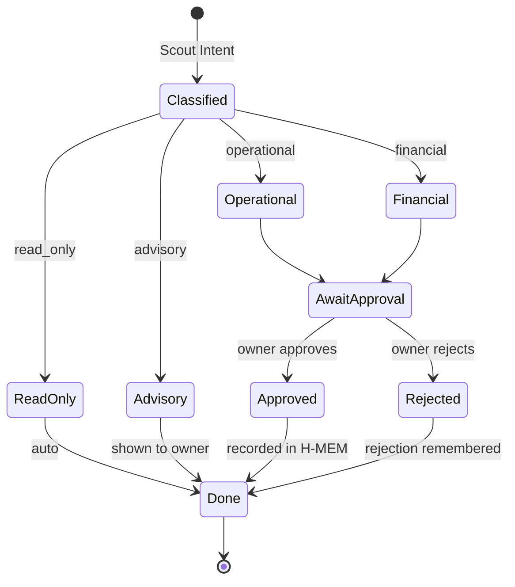
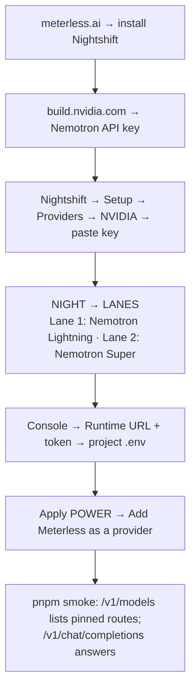

# SmartFlux EDIS: Hackathon Proposal

**Open Agent Hackathon 2026, Track 3: Reasoning Architecture**

> *"TNB tells you what you spent. SmartFlux tells you what to do about it, and proves it worked."*

| | |
| --- | --- |
| Project | SmartFlux EDIS (Energy Demand Intelligence System) |
| Track | **Track 3: Reasoning Architecture** (primary), with Track 2-style evidence-backed answers |
| User | Owner or operator of a self-service laundromat in Malaysia (single outlet first, then franchises) |
| Stack | Zetaris (data) · Meterless Engine H-MEM plus intent routing and risk gating (build) · Meterless Nightshift and NVIDIA Nemotron (power) · any AI coding tool (development) |
| Build window | 22 Oct 2026, 00:00 UTC to 27 Oct 2026, 23:45 UTC. **Internal submit target: 27 Oct, 12:00 UTC** |
| Status | **Final idea, v4 (24 Oct 2026).** A UI prototype exists (pre-existing, will be declared); the agent core is built new in the window |
| Surfaces | **Owner app** (mobile-first PWA) for the laundromat owner, and **Admin web** (desktop) for the SmartFlux operator |
| Entry points | `POST /run` (JSON in, JSON out) · `pnpm agent --input <file>` (CLI) · Owner app · Admin web |

> All times are in UTC. The peak window was checked against TNB's July 2025 ToU scheme (see [§15.1](#151-tariff-periods)). Energy rates come from the original SmartFlux brief and must be checked against TNB's current published schedule before recording (see [§19](#19-risks-and-mitigations)).

### What changed in v4

v3 fixed every rule and reliability gap. v4 raises the ceiling on **Impact** and **Innovation**, the two criteria worth 45 points, using outside research (sources in [§25](#25-sources)).

| # | Change | Why it scores | Section |
| --- | --- | --- | --- |
| 1 | **Solar + ToU as one joint decision.** The agent sizes rooftop solar from the outlet's own half-hourly load and real irradiance, then re-runs the ToU decision on the *remaining* grid load. Solar can flip the ToU verdict | Moves the headline value from RM7.60/month to RM502.75/month for the example outlet. Malaysia's **Solar ATAP** scheme (effective 1 Jan 2026) lets non-domestic users size up to 100% of maximum demand. Interacting decisions are exactly what "Reasoning Architecture" asks for | [§15.6](#156-solar-sizing-and-the-joint-decision) |
| 2 | **Skeptic blocks double-counted savings.** "RM7.60 from ToU + RM502.75 from solar = RM510.35" is rejected because the two interact | A Skeptic job no checklist-style critic would catch; strong collaboration moment for the demo | [§11.2](#112-agents-and-authority) |
| 3 | **Measurement and verification of advice.** After the owner approves "service D4", a later session measures the real kWh/cycle drop and reports **realised** savings (IPMVP-style before/after) | Closes the loop from decision → action → verified outcome; memory changes behaviour | [§15.9](#159-measurement-and-verification-did-the-advice-work) |
| 4 | **Gas and electric dryers handled.** Many laundromat dryers burn LPG; the meter cannot see the burner. Gas dryers are monitored by cycle duration and cycles per hour instead of kWh | Pre-empts the first domain objection a judge with laundromat knowledge will raise | [§15.4](#154-fault-check) |
| 5 | **Weekly autonomous briefing.** Every Monday the agent investigates each outlet unprompted and posts a briefing card | An agent that does work without being asked, not a Q&A box | [§11.6](#116-weekly-autonomous-briefing) |
| 6 | **Scope 2 emissions in the SEDG format** Malaysian SMEs are asked for by larger customers, matching Capital Markets Malaysia's GHG calculator inputs | Real reporting pressure on SMEs since July 2025; turns ESG from decoration into a deliverable | [§15.8](#158-co2-and-scope-2-reporting) |
| 7 | **Benchmark on 30 generated outlets** with random plants: fault precision/recall, ToU and solar verdict accuracy, false flags on humid weeks | Measured reliability, not three hand-picked examples | [§16.4](#164-benchmark) |
| 8 | **Data-access evidence:** Malaysian laundromat payment and telemetry providers already exist (payNwash, Cleanpro's contactless rollout across 300 outlets) | Answers "where would real cycle logs come from?" | [§5.1](#51-the-user) |
| 9 | Data window extended to **six weeks (7 Sep – 18 Oct 2026)** so the post-service recovery is in the data | Needed for #3 | [§16](#16-synthetic-data-plan) |

### What changed in v3 (still in force)

v2 scored about 78/100 on paper and about 63/100 risk-adjusted against the judging materials. v3 fixed every gap that scorecard found.

| # | Change | Why (source) | Section |
| --- | --- | --- | --- |
| 1 | **Sample mode runs real logic** on local cached data with a rules-based reasoner. It never replays saved traces | Disqualification checklist §7: *"real agent logic on cached data, rather than replaying a saved output"* | [§13](#13-run-modes-and-sample-mode) |
| 2 | **Fixed data window** (now Mon 7 Sep – Sun 18 Oct 2026, see v4 #9). Weather from Open-Meteo's archive API for those dates; the generator plants humidity effects on the **real** humid days | v2's live `past_days=31` weather would contradict the planted humid week | [§16](#16-synthetic-data-plan) |
| 3 | Deepavali plant dropped; **Malaysia Day (Wed 16 Sep)** is the real holiday inside the window | Deepavali 2026 falls outside an October window | [§16.2](#162-what-gets-planted) |
| 4 | **`as_of` date on every request**, so session 1 and session 2 see different data | v2's memory demo had no way to show drift | [§11.5](#115-sessions-and-as_of) |
| 5 | **Weekly regression**, not one 4-week fit | A 4-week fit averages D4's week-3 fault away | [§15.3](#153-energy-per-machine-weekly-cycle-regression) |
| 6 | **Skeptic re-queries Zetaris itself** to verify every cited number before approving a claim | Strong-submission example: *"the Evaluator uses Zetaris directly to check claims"*. Stops the Skeptic being a rubber stamp | [§11.2](#112-agents-and-authority) |
| 7 | **SQL constrained to query templates** over the USL model, with a guarded free-SQL escape hatch | LLM-written Lightning SQL fails often; templates make runs predictable | [§11.4](#114-tools-and-query-templates) |
| 8 | **JSONL logs in `logs/` and stdout** with `agent_name`, `target_agent`, `confidence`, `retry_count`, `status` | Mentor playbook §12, weak example 7 | [§12](#12-logs-and-traces) |
| 9 | **Eight input examples and their real outputs**, a CLI, `POST /run`, Docker | Technical guide §1–3; readiness checklist | [§14](#14-entry-points-docker-and-examples) |
| 10 | **Retry and fallback** for Zetaris, Nightshift and the public APIs, each logged | Weak example 11 | [§13.3](#133-failure-handling) |
| 11 | **Trace scene added to the demo**; Nightshift settings moved to one slide | Strong demo structure gives 40 s to the collaboration trace | [§20](#20-demo-script) |
| 12 | **User validation**: at least one real owner conversation before recording, quoted in the deck | Mentor playbook: *"a team with a real user beats a team with better engineering and no user"* | [§5.3](#53-user-validation) |
| 13 | **Cost per cycle vs price per cycle** on the Machines screen and Admin web | Turns energy data into a margin decision the owner cares about | [§4.4](#44-product-surfaces-owner-app-and-admin-web) |
| 14 | Timeline re-planned from tonight; **Builder 1 must be named tonight** | Day 1 is gone; Builder 1 owns the critical path | [§18](#18-implementation-plan) |

---

## Contents

1. [TL;DR](#1-tldr)
2. [The original concept](#2-the-original-concept)
3. [Why the concept had to change](#3-why-the-concept-had-to-change)
4. [The concept of the change](#4-the-concept-of-the-change)
5. [Problem statement and user](#5-problem-statement-and-user)
6. [Objectives and success metrics](#6-objectives-and-success-metrics)
7. [How it solves the track](#7-how-it-solves-the-track)
8. [Hackathon requirements compliance](#8-hackathon-requirements-compliance)
9. [System architecture](#9-system-architecture)
10. [Data layer: Zetaris](#10-data-layer-zetaris)
11. [Agent design](#11-agent-design)
12. [Logs and traces](#12-logs-and-traces)
13. [Run modes and sample mode](#13-run-modes-and-sample-mode)
14. [Entry points, Docker and examples](#14-entry-points-docker-and-examples)
15. [Deterministic calculators (the maths)](#15-deterministic-calculators-the-maths)
16. [Synthetic data plan](#16-synthetic-data-plan)
17. [Build and Power layers: Meterless and NVIDIA](#17-build-and-power-layers-meterless-and-nvidia)
18. [Implementation plan](#18-implementation-plan)
19. [Risks and mitigations](#19-risks-and-mitigations)
20. [Demo script](#20-demo-script)
21. [Path to an A: rubric mapping](#21-path-to-an-a-rubric-mapping)
22. [Submission checklist](#22-submission-checklist)
23. [Open questions](#23-open-questions)
24. [Appendix: worked examples and glossary](#24-appendix-worked-examples-and-glossary)
25. [Sources](#25-sources)

---

## 1. TL;DR

SmartFlux started as an energy dashboard with a chatbot. That shape fails the hackathon brief ("not a chatbot, prompt chain, or UI demo") and rests on assumptions that do not hold: a live 1-second TNB API, and Maximum Demand (MD) surcharges that low-voltage laundromats most likely do not pay.

The revised SmartFlux is an **agent that investigates a laundromat's energy use and makes decisions with evidence**. It joins half-hourly meter data with the machine cycle logs that cashless payment systems already record, and it:

1. **Makes the energy-cost decision as one joined-up answer: solar, tariff, or both.** It sizes rooftop solar from the outlet's own half-hourly load and real irradiance (Solar ATAP, 2026), then re-decides the Time-of-Use (ToU) tariff on the grid load that remains. Solar can flip the ToU verdict, and the agent says so.
2. **Works out energy and cost per machine without sensors**, by regressing interval kWh on machine cycles each week. That gives cost per cycle against the price the customer pays. Gas dryers, which the meter cannot fully see, are tracked by cycle duration.
3. **Detects faulty machines** (for example a dryer using 33% more energy per cycle) and rules out false causes like humid weather by comparing peers. The faulty dryers in our sample outlets waste RM48–85 a month each.
4. **Acts, then checks its own advice.** Operational and financial actions wait for owner approval. After the owner acts, a later session measures the realised saving against the baseline in memory.
5. **Works without being asked.** Every Monday it investigates each outlet and posts a briefing. It also produces the Scope 2 emissions figures Malaysian SMEs are now asked for.

Every answer carries the SQL it ran, the numbers it computed, and a Skeptic's verdict that was **checked by re-querying the data**, including a check that savings from interacting decisions are not double-counted. Zetaris is the only data path, Meterless H-MEM remembers each machine's baseline and every past recommendation, Meterless Scout Intent routes requests and gates risky actions, and NVIDIA Nemotron on Meterless Nightshift does the reasoning.

The owner uses a **mobile-first Owner app** (briefings, decision cards, approvals). The SmartFlux operator uses a one-page **Admin web** across all outlets. A judge can skip both and call `POST /run`, or run the whole system with **no credentials** in sample mode, which still runs the real agent logic.

---

## 2. The original concept

| Pillar | Original feature | Original claim |
| --- | --- | --- |
| Observation | Live dashboard and NILM | Live kW gauge, 60-minute trend, split into Heating, Motor and Base load from TNB data at about 1 reading per second |
| Mitigation | Peak Demand engine | At 90% of the limit, pause `ceil((live_kW − limit) / 5)` dryers for 15 minutes |
| Optimisation | ToU engine and Smart Shift Scheduler | Shift dryer cycles to off-peak, with an RM savings estimate |
| Sustainability | ESG and carbon tracker | CO₂ saved, efficiency score, regional peer ranking, ESG export |
| (extra) | FluxAI | Gemini chatbot giving one recommendation in under 150 words |
| (pitch) | Framework stack | LangGraph workflow, Zetaris joining smart meter logs with PDF manuals, Meterless for memory |
| (pitch) | Prescriptive alert | "Shift heavy drying loads after 10 PM to save RM456/month", plus a "Night Owl Discount" promo |
| (pitch) | Admin platform | JWT sign-up with TNB account number, 3-role RBAC, TNB Enterprise API Gateway monitor, subscription analytics, NILM confidence histogram, broadcast engine, audit logs |

The prototype is a pnpm monorepo: Express 5 and TypeScript backend, React 18 and Vite frontend, in-memory mock data (1 user, 4 records), no auth, no database, hardcoded forecast and percentile numbers, and two different CO₂ factors (0.4 and 0.694).

---

## 3. Why the concept had to change

| # | Issue | Evidence | Consequence |
| --- | --- | --- | --- |
| 1 | **It is a dashboard plus a chatbot, not an agent** | The brief excludes chatbots, prompt chains and UI-only demos | Fails the basic bar regardless of polish |
| 2 | **MD surcharges probably do not apply** | The brief's own rates list capacity (8.83 sen) and network (14.82 sen) charges **per kWh**, the low-voltage structure since July 2025. MD (RM/kW) applies to medium voltage; a shop-lot laundromat is almost certainly low voltage | The Mitigation pillar targets a charge the customer does not pay |
| 3 | **Energy savings are smaller than the price** | Peak/off-peak gap is RM0.0409/kWh. For 4,000 kWh/month: switching saves about RM14, shifting 15% saves about RM25 | About RM39/month against an RM79–299 subscription. "RM456/month from shifting" needs about 11,000 kWh moved, more than the outlet uses |
| 4 | **No live 1 Hz TNB API for third parties** | Smart meters record half-hourly intervals, reached through myTNB or an owner export | Live NILM, real-time alerts and "hardware-free" in that form collapse |
| 5 | **Pausing customers' dryers mid-cycle** | Customers paid for a full cycle | Complaints, refunds, lost revenue |
| 6 | **Gemini as the model provider** | The Power rule requires Meterless Nightshift as the primary AI provider | Fails a hard requirement |
| 7 | **Pre-existing prototype** | Pre-existing code must be declared; Wildcard scores only new work and caps at $1,000 | The agent core must be new work in the build window |
| 8 | **The pitch's stack leaves out the Power layer** | LangGraph is not a sponsor technology; Nightshift and Nemotron are missing | Fails the Power rule |
| 9 | **The admin feature list is mostly unscored or fictional** | No TNB Enterprise API exists to monitor; subscriptions, audit logs and RBAC earn no rubric points | About 2 build days on CRUD instead of the agent. Triaged in [§4.4](#44-product-surfaces-owner-app-and-admin-web) |

---

## 4. The concept of the change

### 4.1 From dashboard to agent



### 4.2 Feature-by-feature change

| Original | Revised | Why |
| --- | --- | --- |
| Live kW gauge from 1 Hz TNB API | Half-hourly meter data (owner export or myTNB download) | That is the data that exists |
| Rate-of-change NILM | **Weekly cycle-log regression**: interval kWh against cycles per machine | Works on coarse data, gives per-machine numbers, explainable |
| MD Peak Demand engine (pause dryers) | **Optional MD module** for medium-voltage sites only; "hold the next start", never stop a running cycle | MD likely irrelevant for low voltage; protects customers |
| ToU timetable and savings estimate | **ToU switch decision** with breakeven, worst week and RM impact | Turns the "confidence layer" pitch into a computed answer |
| (none) | **Solar sizing joined with the ToU decision** (Solar ATAP) | Largest RM decision an owner makes on energy; interacts with ToU |
| (none) | **Machine fault detection** for electric and gas dryers, with weather ruled out by peers | Biggest recurring RM value, plus fewer lint-related breakdowns |
| (none) | **Measurement and verification** of approved actions | Proves the advice worked, in RM |
| (none) | **Weekly autonomous briefing** per outlet | Proactive, not only reactive |
| (none) | **Cost per cycle vs price per cycle** per machine | Margin per machine: a pricing decision the owner can act on |
| Smart Shift Scheduler | **Load-shift plan** with owner-approved actions | Same intent, now gated and measured |
| ESG tracker with hardcoded percentile | **Scope 2 summary in SEDG format**, one Energy Commission grid factor stored in Zetaris; LPG (Scope 1) where gas dryers are used | No fake numbers; matches what SMEs are now asked to report |
| FluxAI Gemini chatbot | **Agent team on Nemotron via Nightshift**, every step logged | Meets the Power rule and the "real work" bar |
| Plans, payments, auth | Payments out of scope; demo login with 2 hardcoded roles | Earns no points in the build window |
| "Night Owl Discount" | Off-peak promo proposed by the agent, **activated only after owner approval** | Same idea, gated and measured |
| Push alert to owner's phone | In-app alert card in the Owner app (PWA) | No native app needed |

### 4.3 What stays

- The positioning: hardware-free, built for Malaysian laundromats, the "confidence layer" for ToU.
- The React app, reused for the Owner app and Admin web (declared as pre-existing).
- The tariff knowledge, now stored once in Zetaris instead of hardcoded in two apps.

### 4.4 Product surfaces: Owner app and Admin web

Both surfaces are one React app with two route groups behind a demo login. **Both are kept.** The Owner app carries the demo; the Admin web is one page that shows the franchise view.

> "Customer" in the pitch means the **laundromat owner** (the SmartFlux subscriber). Walk-in customers who use the machines only see the result of an approved promo. There is no app for them.

**Owner app (mobile-first PWA, designed at 390 px wide)**

| Screen | What it shows | Source |
| --- | --- | --- |
| Home | **Monday briefing card**, alert cards (flagged machine, peak share this week), this month's kWh, RM and projected bill, realised savings from past advice | Weekly briefing run, `tou_calc`, `mv_check` |
| Energy plan | Solar size, payback and monthly saving; ToU verdict before and after solar; one recommended combination | `solar_calc`, `tou_calc` |
| Ask | Free-text question in English or Malay ("Patut saya tukar ke ToU?"), plus 4 suggested questions | `POST /run` |
| Decision card | Verdict, RM impact, confidence, ruled-out list, "Show evidence" | Reporter output |
| Evidence | Agent timeline (who asked whom, what was rejected), SQL run, calculator inputs and outputs, Skeptic verification query, models used | `logs/<run_id>.jsonl` |
| Approvals | Pending actions (service D4, Saturday 22:00 promo) with approve / reject and the risk level | `propose_action`, Scout Intent |
| Machines | Per machine: kWh per cycle (with error bar) or, for gas dryers, minutes per cycle; **energy cost per cycle vs price per cycle**; trend vs baseline; "serviced on" and verified saving | `regress_machines`, `fault_check`, `mv_check`, `machine_cycles.price_rm` |

**Admin web (desktop, one page)**

| Feature from the pitch | Decision | Reason |
| --- | --- | --- |
| Sign-in / sign-up with JWT, TNB account number | **Simplified**: demo login with 2 hardcoded users (owner, admin) | Auth earns no points |
| RBAC (Super Admin, Admin, Customer) | **Simplified**: 2 roles | Same demo value, a fraction of the work |
| Energy and peak impact chart (all outlets) | **Keep**: stacked bar, peak vs off-peak kWh per outlet, by week | Cheap, reads well on video |
| KPI summary (load, cost, revenue, margin, bill projection) | **Keep**, calculator numbers only | Revenue from `machine_cycles.price_rm`; no hardcoded figures |
| Consumption disaggregation (washers vs dryers) | **Keep**, from cycle regression | It is the agent's real output |
| (new) Flagged machines across outlets | **Keep**: table of `fault_check` flags with RM waste and approval status | Shows the franchise value |
| (new) Run log | **Keep**: last 20 agent runs (including Monday briefings) with intent, verdict, mode and link to the trace | Makes the agent's work visible to an operator and a judge |
| (new) Advice scoreboard | **Keep**: approved actions per outlet with predicted vs verified RM saving | Shows the agent is right, in money |
| (new) Scope 2 export | **Keep**: per-outlet kWh, tCO₂e and method note in SEDG format (CSV) | Real reporting deliverable for franchise operators |
| NILM confidence histogram | **Cut**: replaced by regression R² and per-machine standard error | We do not use NILM |
| TNB Enterprise API Gateway monitor | **Cut** | No such third-party API exists |
| Subscription page and donut chart | **Roadmap** | Payments out of scope |
| System-wide alert broadcast | **Stretch**: one textbox that shows a banner in the Owner app | Only if 25 Oct finishes on time |
| Security audit and compliance logs | **Cut**: agent logs and H-MEM approval records already form the audit trail | No duplicate logging |

---

## 5. Problem statement and user

> **We are building an agent that helps a Malaysian laundromat owner decide how to cut their energy bill (install solar, switch to the ToU tariff, or both), find which machines are wasting energy, and check whether each fix actually worked, by investigating their meter data and machine cycle logs together, and producing decisions with RM impact, evidence and ruled-out alternatives.**

### 5.1 The user

| | |
| --- | --- |
| Who | Owner or operator of a self-service laundromat, typically 8–20 machines, often absentee or part-time |
| What they have | A monthly TNB bill, a myTNB account, and a cashless payment system that logs every machine cycle. In Malaysia this data already exists: providers such as payNwash sell cashless readers with telemetry and remote machine management, and Cleanpro Express rolled out contactless payment across 300 outlets in 2019 ([§25](#25-sources)) |
| What they lack | Any link between the two: which machine, which hour and which tariff drive the bill |
| What they're being sold | Solar quotes from installers who target laundromats, sized on the bill rather than on when the load actually happens |
| What they fear | Switching to ToU and paying more; buying the wrong solar size; a machine silently wasting money until it breaks |
| Decisions they need | "Solar, ToU, or both?", "Which machine needs servicing?", "Did the fix work?", "Is each machine still profitable per cycle?", "When should heavy loads run?" |

### 5.2 Why an agent and not a dashboard

The questions are investigations, not lookups. "Why was September expensive?" needs hypotheses (more customers? the holiday? humid weeks? a faulty dryer?), queries across several sources to test each, arithmetic the model must not guess, a check that the evidence supports the claim, and memory of what each machine normally uses. A dashboard shows numbers. The agent reaches a conclusion, shows why, and says what it ruled out.

### 5.3 User validation

Impact is 30 points and the tie-breaker, and the judges' materials reward a real user. Before recording (by 26 Oct, 06:00):

| Step | Detail | Owner |
| --- | --- | --- |
| 1 | Talk to **at least one real laundromat owner or operator** (in person, phone or WhatsApp). Two is better | Jatul |
| 2 | Ask: Are you on ToU? Why or why not? Have you been offered solar, and how was it sized? Are your dryers gas or electric? Has a machine ever wasted energy before it broke? How did you find out? Does your payment system export cycle logs, and in what format? What would you pay to know which machine is costing you? | Jatul |
| 3 | Record one quotable sentence (with permission, first name or "an Ipoh laundromat owner") for slide 1 and the demo opening | Dina |
| 4 | Feed the answers into §23 (open questions 1 and 3) and the roadmap slide | Jatul |

If no owner can be reached in time, say so honestly in the deck and cite public evidence (TNB's ToU announcement, laundromat franchise counts) instead. Never invent a quote.

### 5.4 Business case (stated honestly)

| Value | Size (OUT-01, 4,000 kWh/month) | Frequency |
| --- | --- | --- |
| **Solar sized on the outlet's own load** | About **RM503/month** for 10 kWp, payback about 5.8 years ([§24.3](#243-solar--tou-joint-example-out-01)); avoids an oversized system that exports at low value | One-off, the largest energy decision an owner makes |
| ToU switch decision | RM7.60/month grid-only; **after solar, ToU costs RM1.39/month more**, so the right call flips to "stay" | One-off, high anxiety |
| Load shifting | About RM25/month for 15% of load moved | Ongoing |
| Fault detection | RM48–85/month per faulty dryer in our sample outlets, plus customer throughput lost to longer cycles; lint and vent problems are also a safety issue | Occasional; frequency to be confirmed with owners (§5.3) |
| Verified savings | Every approved action reported as predicted vs realised RM | Ongoing; builds trust in the advice |
| Cost vs price per cycle | Finds machines priced below their energy cost after a tariff change | Ongoing |
| Scope 2 report | Saves the owner preparing the emissions figures larger customers and lenders ask for | Yearly or on request |

The pitch leads with the joint solar/ToU decision and verified fault savings, not with tariff arithmetic. Solar figures depend on assumed system cost and yield, which are stored as data and shown on the card.

---

## 6. Objectives and success metrics

| # | Objective | Measurable result | Checked by |
| --- | --- | --- | --- |
| O1 | Make the ToU decision safe | Correct switch or stay verdict for every outlet on both datasets, with breakeven, worst week and RM difference matching the calculator to the sen | `calc/tou.test.ts`, `eval/run-eval.ts` |
| O2 | Attribute energy to machines without hardware | Recovered kWh per cycle within ±10% of the planted value for ≥ 95% of dryer-weeks, every miss listed | `calc/regress.test.ts` |
| O3 | Find faulty machines | Flags the planted faulty dryer on both datasets; **never** flags the humid week or the noisy washer | `eval/run-eval.ts` |
| O4 | Recommend load shifting safely | Shift plan with RM savings; no operational or financial action runs without approval | `engines/scout/risk.test.ts` |
| O5 | Remember across sessions | Session 2 (`as_of` 4 Oct) uses baselines learned in session 1 (`as_of` 13 Sep) after a restart, visible in the log | `engines/hmem/memory.test.ts` |
| O6 | Explain every answer | Each output links to a JSONL log with every agent step, SQL, calculator I/O, Skeptic verification and model | Log schema test |
| O7 | Work without our machines | `SAMPLE_MODE=true` from a fresh clone, empty `.env`, Zetaris and Nightshift stopped: all 8 examples produce real, different outputs | Clean-clone script ([§22](#22-submission-checklist)) |
| O8 | Meet every sponsor rule | Compliance matrix in [§8](#8-hackathon-requirements-compliance) fully checked with evidence | Checklist |
| O9 | Make the joint energy decision | Solar size and payback match the calculator; the ToU verdict is recomputed on post-solar load; the Skeptic rejects any summed saving that ignores the interaction | `calc/solar.test.ts`, `eval/run-eval.ts` |
| O10 | Verify advice | Session 3 (`as_of` 18 Oct) reports D4's realised saving within ±15% of the planted recovery | `calc/mv.test.ts` |
| O11 | Handle gas dryers | Planted gas-dryer fault at OUT-02 is found from cycle duration; no electric kWh claim is made for a gas burner | `eval/run-eval.ts` |
| O12 | Reliability at scale | Benchmark on 30 generated outlets: ToU and solar verdicts 100% match the calculator; fault recall ≥ 90%; ≤ 1 false flag across all humid weeks | `eval/benchmark.ts` |

Non-goals: payments, real auth, multi-tenancy, native mobile apps, live sub-minute monitoring, TNB API gateway monitoring, subscription analytics, audit logs, peer ranking, PDF export.

---

## 7. How it solves the track

**Track 3, Reasoning Architecture:** *demonstrate a novel ability to turn data, knowledge, memory and reasoning into reliable decisions and actions.*

| Track element | SmartFlux implementation |
| --- | --- |
| **Data** | Meter intervals, machine cycles, machine registry, tariffs, public holidays and weather, all queried through Zetaris |
| **Knowledge** | Tariff rules and peak windows stored as data; laundromat domain rules (dryers are the heavy load, humidity lengthens drying) in the role prompts |
| **Memory** | Meterless H-MEM: each machine's baseline kWh per cycle, past recommendations, owner approvals and rejections, measured outcomes |
| **Reasoning** | Planner forms hypotheses, Investigator tests them through query templates, Skeptic challenges correlation versus cause and re-queries to verify, on Nemotron |
| **Reliable** | Money and regression maths in tested code, never the LLM; Skeptic can block the Reporter; capped loops; retries and fallbacks; tested on a second dataset |
| **Decisions** | Solar size, tariff, or both (decided jointly, because they interact); which machine to service; which machines are under-priced; which loads to move |
| **Actions** | Owner-approved actions (hold next dryer start, schedule servicing, run off-peak promo, request a solar quote at a given size), gated by Scout Intent risk levels |
| **Reliable, measured** | Each approved action is checked later against the remembered baseline and reported as realised RM; a 30-outlet benchmark measures accuracy |

The novel parts judges should remember:

1. **Sensor-free, per-machine energy accounting from payment logs.** Low-frequency disaggregation is hard when only the aggregate meter is known ([§25](#25-sources)); SmartFlux turns it into a regression by using the payment system's cycle start and end times as labels.
2. **Decisions that interact are reasoned about together.** Solar changes the ToU answer; the Skeptic blocks savings that would be double-counted.
3. **The agent checks whether its own advice worked**, and remembers the answer.
4. **No money claim reaches the owner until the Skeptic has re-derived it from Zetaris.**

---

## 8. Hackathon requirements compliance

| Requirement | Source | How SmartFlux meets it | Evidence for judges |
| --- | --- | --- | --- |
| **Zetaris integrated with a real role** | Rules, Data rule | Every live data access goes through `run_sql` against Zetaris: a Postgres datasource and a live REST-API table (Open-Meteo weather) federated in one query, and a USL model the templates query | Zetaris UI screenshot; `zetaris.query` events in logs; federated query in README |
| **At least one Meterless Engine in a working feature, with a passing test** | Rules, Build rule | **H-MEM** powers machine health (baselines across sessions). **Scout Intent** powers routing and action gating | `memory.test.ts`, `routing.test.ts`, `risk.test.ts` output in README; code paths named |
| **Meterless Nightshift as primary AI provider** | Rules, Power rule | Every LLM call uses one OpenAI-compatible client pointed at the Nightshift Runtime URL | `model` field on every LLM-backed log event |
| **NVIDIA Nemotron (for the DGX Spark award)** | Rules §15 | Fast lane Nemotron Lightning for Scout, Planner, Investigator; Deep lane Nemotron Super for Skeptic and Reporter; routes pinned | Model name on every LLM-backed log event |
| **AI coding tool (any; Cursor optional)** | Rules §145 | Built with Claude Code; Cursor only if a team member uses it (needed only for the Cursor award) | README "Built with" line |
| **Working agent, not a chatbot** | Brief | Five roles with distinct authority, two feedback loops, tool use, approvals | Logs, demo |
| **Programmatic entry point** | Technical guide §2 | `POST /run` on `0.0.0.0:8000` and `pnpm agent --input` | README usage section |
| **Logs** | Technical guide §1 | JSONL to `logs/` and stdout | `logs/` after any run |
| **Sample inputs and outputs** | Technical guide §1 | 8 inputs in `input_examples/`, real saved outputs in `output_examples/` | Repo |
| **Sample mode runs real logic** | Disqualification checklist §7 | `SAMPLE_MODE=true`: local SQLite over cached CSVs + rules-based reasoner + same calculators | Clean-clone test output |
| **No hardcoded outputs** | Disqualification checklist §8 | No code reads `output_examples/`; outputs differ across inputs and datasets | Seed 2 run in README |
| **No committed secrets** | Rules | `.env` gitignored, `.env.example` placeholders; NVIDIA key only in Nightshift | Secret scan before submit |
| **Pre-existing code declared** | Rules | React shell, Express skeleton declared | Submission form; `PRE_EXISTING.md` |
| **Runs from a clean setup** | Submission checklist | `docker compose up` or `pnpm i && pnpm dev`; data generated and loaded by script | Clean-clone script |

---

## 9. System architecture

### 9.1 Layered view



### 9.2 Where each sponsor sits



### 9.3 One request through every layer

```mermaid
sequenceDiagram
    autonumber
    actor Owner
    participant API as POST /run
    participant Scout as Scout Intent
    participant Mem as H-MEM
    participant P as Planner
    participant I as Investigator
    participant S as Skeptic
    participant R as Reporter
    participant Z as Zetaris
    participant Calc as Calculators

    Owner->>API: "Why was my bill higher? Should I switch to ToU?" (as_of 2026-10-04)
    API->>Scout: classify
    Scout-->>API: [bill_investigation, tariff_decision], risk read_only
    API->>Mem: recall OUT-01
    Mem-->>P: D4 baseline 2.1 kWh/cycle (learned as_of 13 Sep)
    P->>I: 4 hypotheses: traffic, holiday, humidity, machine fault
    I->>Z: template tou_split(OUT-01, 4 weeks)
    Z-->>I: rows
    I->>Calc: tou_calc → peak 54.8%, breakeven 63.6%, worst week 59.1%
    I->>Z: template dryer_cycle_day + interval_usage (weekly)
    I->>Calc: regress_machines + fault_check
    Calc-->>I: D4 2.8 kWh/cycle (+33%), peers +4%
    I->>S: claims: "D4 faulty", "humidity caused the rise", "ToU cheaper"
    S->>Z: verification query: peers' kWh/cycle in the humid week
    Z-->>S: peers +4% in week 3, D4 +33% in weeks 3–4
    S-->>I: reject "humidity caused the rise" (explains only +4%); ask for D4 cycle durations
    I->>Z: template cycle_duration(D4)
    Z-->>I: median 52 → 61 min (+17%)
    I->>S: resubmit
    S-->>R: approve "D4 faulty", "ToU cheaper"; ruled out: humidity, holiday traffic
    R->>Mem: write D4 reading + "advised: service D4"
    R-->>API: decision cards + proposed action "service D4" (operational)
    API-->>Owner: cards, evidence, approval request
    Owner->>API: POST /approve (service D4)
    API->>Mem: record approval; outcome checked next session
```

---

## 10. Data layer: Zetaris

### 10.1 Why Zetaris is the center

The owner's data lives in places that never meet: TNB meter exports, the payment system's cycle log, the tariff schedule, the holiday calendar and the weather. Zetaris puts all of them behind one SQL endpoint, so the agent asks one system and never maintains a connector per source. Two public REST APIs become SQL tables the same way the PokéAPI starter recipe does, and a **Unified Semantic Layer (USL)** gives the agent one business view (`interval_usage`, `dryer_cycle_day`) instead of raw source tables. If Zetaris is removed, live mode has no data: it is load-bearing.

> Source of truth for setup and syntax: Zetaris's [getting-started repository](https://github.com/zetaris/getting-started/tree/44668b267ad7ee0fae25ce7588e9620121d47cae), summarised in the hackathon resource pack's Zetaris sponsor overview (not redistributed in this repo).

### 10.2 Sources

| Source | Type in Zetaris | Real-world origin | Hackathon version |
| --- | --- | --- | --- |
| `outlets` | Postgres table (via `CREATE DATASOURCE smartflux_pg`) | SmartFlux onboarding | Synthetic, 3 outlets (Ipoh, Shah Alam, Johor Bahru) |
| `machines` | Postgres table | Payment system machine registry | Synthetic, 8 washers + 6 dryers per outlet; `heat_source` electric or gas |
| `meter_readings` | Postgres table | myTNB / smart meter export, 30-min intervals | Synthetic, 7 Sep – 18 Oct 2026, 2,016 rows per outlet |
| `service_log` | Postgres table | Owner or technician records | Synthetic; D4 serviced Tue 6 Oct |
| `solar_params` | Postgres table | Installer quotes, Solar ATAP rules | System cost per kWp, derate, roof limit per outlet, scheme cap; every value shown on the card as an assumption |
| `machine_cycles` | Postgres table | Cashless payment system logs | Synthetic, about 10,000 cycles in total (seed 1) |
| `tariffs` | Postgres table | TNB published schedule | Rates from the brief, checked against TNB before recording |
| `emission_factors` | Postgres table | Energy Commission grid factor | One value, cited (replaces 0.4 vs 0.694) |
| `holidays` | Postgres table (static; Nager.Date has no Malaysia data, so dates come from the public Malaysia holiday calendar, fetched once) | Public holiday calendar | Static table; Malaysia Day (16 Sep) falls in the window |
| `weather` | **REST table** per outlet in `weather_rest` | Open-Meteo **archive** API, fixed dates, hourly humidity, temperature and **shortwave radiation** (no key) | Live public API, unnested with a schemastore view; radiation drives the solar yield |

> Zetaris cannot read files on your laptop. The synthetic CSVs are loaded into a separate Postgres container, registered with `CREATE DATASOURCE` and `REGISTER DATASOURCE TABLES`. The Postgres host must be reachable **from the Zetaris containers** (same Docker network, or `host.docker.internal`).

### 10.3 Data model



### 10.4 Setup steps



All create statements live in `infra/zetaris/*_create.sql`. `pnpm zetaris:setup` sends them one statement per call, prints each first with `--dry-run`, and is run by a person, never by the agent.

```sql
-- infra/zetaris/01_sources_create.sql (one statement per call, no trailing semicolons when sent)
CREATE DATASOURCE smartflux_pg DESCRIBE BY "SmartFlux synthetic data" OPTIONS (
  jdbcdriver "org.postgresql.Driver",
  jdbcurl "jdbc:postgresql://smartflux-pg:5432/smartflux",
  username "smartflux",
  password "<from .env, never committed>"
)

REGISTER DATASOURCE TABLES FROM smartflux_pg

-- holidays: a Postgres table (Nager.Date returns no data for Malaysia; checked 24 Oct)

CREATE LIGHTNING DATABASE weather_rest DESCRIBE BY "Open-Meteo archive, hourly, 7 Sep - 18 Oct 2026"

CREATE LIGHTNING REST TABLE out_01 FROM weather_rest REQUEST (
  endpoint "https://archive-api.open-meteo.com/v1/archive?latitude=4.5975&longitude=101.0901&start_date=2026-09-07&end_date=2026-10-18&hourly=relative_humidity_2m,temperature_2m,shortwave_radiation&timezone=Asia%2FKuala_Lumpur",
  method "get",
  response_type "json",
  http_encoding "URLENCODED"
) HEADER () BODY ()
-- out_02 (Shah Alam 3.0733, 101.5185) and out_03 (Johor Bahru 1.4927, 103.7414) follow the same shape
```

Open-Meteo returns parallel arrays (`hourly.time[]`, `hourly.relative_humidity_2m[]`). A `CREATE SCHEMASTORE VIEW ... LATERAL VIEW posexplode(...)` turns them into one row per hour, as the PokéAPI recipe unnests `abilities`. Check the exact shape in the Lightning SQL companion first. Fallback if unnesting fails: load the cached weather CSV into Postgres and keep holidays as the REST table.

Fixed dates mean the live API returns the same rows every time, so a judge's run matches ours.

### 10.5 The federated query (the demo moment)

```sql
-- Energy context per dryer per day, with humidity and holiday flags
SELECT  c.machine_id,
        CAST(c.started_at AS DATE)                AS day,
        COUNT(*)                                  AS cycles,
        AVG(w.relative_humidity)                  AS avg_humidity,
        MAX(CASE WHEN h.date IS NOT NULL THEN 1 ELSE 0 END) AS is_holiday
FROM    smartflux_pg.machine_cycles c
JOIN    smartflux_pg.machines m        ON m.machine_id = c.machine_id
LEFT JOIN weather_view.out_01_hourly w ON w.hour = date_trunc('HOUR', c.started_at)
LEFT JOIN holidays_rest.my_2026 h      ON CAST(h.date AS DATE) = CAST(c.started_at AS DATE)
WHERE   m.type = 'dryer' AND m.outlet_id = 'OUT-01'
GROUP BY c.machine_id, CAST(c.started_at AS DATE)
```

### 10.6 Unified Semantic Layer

```sql
CREATE NAMESPACE IF NOT EXISTS lightning.metastore.smartflux

COMPILE USL energy DEPLOY NAMESPACE lightning.metastore.smartflux DDL
CREATE TABLE interval_usage (
  outlet_id varchar(10) NOT NULL,
  interval_start timestamp NOT NULL,
  week int,
  kwh double,
  period varchar(8),
  is_holiday int
);
CREATE TABLE dryer_cycle_day (
  machine_id varchar(10) NOT NULL,
  day date NOT NULL,
  week int,
  cycles int,
  median_minutes double,
  avg_humidity double,
  is_holiday int
)
```

Each table is filled with `ACTIVATE USL TABLE lightning.metastore.smartflux.energy.<table> AS SELECT ...`. The peak/off-peak/holiday rules live here once. All query templates ([§11.4](#114-tools-and-query-templates)) read these tables.

### 10.7 Calling Zetaris from the backend

```ts
// apps/backend/src/adapters/zetaris.ts
import { randomUUID } from "node:crypto";

export async function runSql(sql: string) {
  const r = await fetch(`${process.env.ZETARIS_REST_URL}/sql-editor/sqls/run`, {
    method: "POST",
    headers: {
      Authorization: `Bearer ${process.env.ZETARIS_API_KEY}`,
      "X-Org-ID": process.env.ZETARIS_ORG_ID!,
      "X-Request-ID": randomUUID(),
      "Content-Type": "application/json",
    },
    body: JSON.stringify({ sql: sql.trim().replace(/;$/, "") }), // path + body shape: confirm in /redoc/docs.yaml
    signal: AbortSignal.timeout(30_000),
  });
  if (!r.ok) throw new Error(`Zetaris ${r.status}: ${await r.text()}`);
  return r.json();
}
```

The SQL run path is not documented in the getting-started repo. **Tonight's smoke test** fetches the OpenAPI spec from `${ZETARIS_REST_URL}/redoc/docs.yaml` (Basic auth) and fixes the path and body. Fallbacks: the UI proxy route (`ZETARIS_BASE_URL`, `/api/proxy/...`) or JDBC at `jdbc:zetaris:lightning@localhost:10000`.

Rules from Zetaris's `AGENTS.md` that the agent follows:

- Lightning SQL only, one statement per call, **no trailing semicolon**, qualified `<source>.<table>` names.
- Read-only: `run_sql` rejects anything that is not `SELECT`, `SHOW` or `DESCRIBE`.
- Never print, log or put credentials in a URL; never call port 8889 on a local instance.
- Confirm a connection with `SELECT 1` and `SHOW LIGHTNING DATABASES`.

---

## 11. Agent design

### 11.1 Shape

Not a chain. A state machine around shared run state, with two feedback loops and one hard block:



Caps: at most 3 Skeptic rejections per claim, 2 Planner re-plans and 30 tool calls (queries plus calculator runs) per run. When a cap is hit, the Reporter states what was verified and lists the rest as **unresolved**, never as findings. A typical run takes under 2 minutes live and under 5 seconds in sample mode.

### 11.2 Agents and authority

| Agent | Lane | Owns | Can block or send back? | What makes it more than a prompt |
| --- | --- | --- | --- | --- |
| **Scout** | Fast | Intent(s) and risk level | Yes: refuses out-of-scope requests | Meterless Scout Intent engine with a labelled routing test |
| **Planner** | Fast | Hypotheses and which templates to run; re-plans when the Skeptic finds nothing survives | Yes: drops hypotheses | Reads H-MEM; its plan changes when memory or Skeptic feedback changes |
| **Investigator** | none (deterministic tool runner, decided 24 Oct) | Runs templates and calculators, collects evidence rows | Retries a failed or empty query with a narrower window | Tool use only; never states a number it did not compute |
| **Skeptic** | Deep | Approves or rejects each claim | **Yes: the Reporter only receives approved claims** | Runs its own verification queries against Zetaris before approving; checks peers, timing and alternative causes; **rejects savings that are summed across interacting decisions** (solar and ToU, shifting and ToU) and sends them back to be recomputed jointly; rejects electric-kWh claims about gas burners |
| **Reporter** | Deep | Decision cards in English or Malay; proposed actions with risk level | No | Writes only from approved claims and calculator outputs |

The Skeptic's verification is the "unique use of sponsor tech" line for the deck: **no money claim reaches the owner until the Skeptic has re-derived it from Zetaris.**

### 11.3 Shared run state

```ts
type RunState = {
  run_id: string; as_of: string; outlet_id: string; question: string; lang: "en" | "ms";
  intents: string[]; risk: "read_only" | "advisory" | "operational" | "financial";
  memory: MemoryItem[];               // from H-MEM
  hypotheses: Hypothesis[];           // status: open | supported | rejected | unresolved
  evidence: Evidence[];               // template, params, rows, calculator I/O
  claims: Claim[];                    // status: proposed | approved | rejected
  actions: ProposedAction[];          // status: awaiting_approval | approved | rejected
  counters: { tool_calls: number; replans: number; rejections: Record<string, number> };
  mode: { data: "zetaris" | "local"; llm: "nightshift" | "rules" };
};
```

Every agent reads and writes this one object. The Evidence screen and the logs are both rendered from it.

### 11.4 Tools and query templates

| Tool | Kind | Input | Output |
| --- | --- | --- | --- |
| `query(template, params)` | Zetaris or local | One of the templates below | Rows (capped at 500) |
| `run_sql(sql)` | Zetaris, guarded | One read-only statement against `lightning.metastore.smartflux.*` only | Rows; used only when no template fits, and logged as such |
| `tou_calc` | Code | kWh by period per week, tariff rows | Cost on each tariff, peak share, breakeven, worst week, verdict |
| `regress_machines` | Code | Interval kWh, cycle overlap matrix, week | kWh per cycle per machine, base load, R², standard errors |
| `fault_check` | Code | Weekly e_m, H-MEM baseline, peers, durations | Flag, delta %, peer delta %, duration delta % |
| `margin_calc` | Code | e_m, blended rate, price per cycle | Energy cost per cycle, margin per cycle |
| `solar_calc` | Code | Half-hourly load, hourly radiation, `solar_params`, tariff rows | Size options, generation, self-consumed share, RM saving, payback, **post-solar load profile** |
| `joint_decision` | Code | Grid-only and post-solar `tou_calc` results, solar options | The best combination and why; the interaction stated as a number |
| `mv_check` | Code | Baseline (H-MEM), pre-action and post-action weeks, service date | Realised saving with error band; "verified", "not yet" or "not achieved" |
| `shift_plan` | Code | Hourly dryer starts, off-peak idle capacity | Shiftable kWh, RM saving, suggested holds and promos |
| `co2_calc` | Code | kWh saved, emission factor | kg CO₂ |
| `memory_recall` / `memory_write` | H-MEM | Outlet, machine | Baselines, history |
| `propose_action` | Code | Action type, target, reason | Pending approval record with risk level |

Query templates (each has a Lightning SQL version and a SQLite version, tested to return identical rows on the sample data):

| Template | Params | Reads |
| --- | --- | --- |
| `tou_split` | outlet, from, to | `interval_usage` |
| `interval_series` | outlet, week | `interval_usage` |
| `cycle_overlap` | outlet, week | `machine_cycles` |
| `dryer_cycle_day` | outlet, from, to | `dryer_cycle_day` (federated: cycles + weather + holidays) |
| `cycle_duration` | machine, from, to | `dryer_cycle_day` |
| `peer_week_delta` | outlet, type, week | `dryer_cycle_day` (Skeptic's main verification query) |
| `cycle_prices` | outlet | `machine_cycles` |
| `solar_inputs` | outlet, from, to | `interval_usage` + `weather` radiation (federated) + `solar_params` |
| `service_history` | machine | `service_log` |

The LLM chooses templates and parameters and explains results. It never writes the money maths, and free SQL is the exception, not the path.

### 11.5 Sessions and `as_of`

Every request carries `as_of`. Templates only see data up to that date, and H-MEM stores the `as_of` each memory was learned at.

| Session | `as_of` | What happens |
| --- | --- | --- |
| 1 | Sun 13 Sep | Week 1 only. Regression learns baselines (D4 2.1 kWh/cycle, 52 min). H-MEM stores them. Agent advises a Saturday 22:00 promo |
| (restart) | | Process restarted; H-MEM persists in `data/hmem/` |
| 2 | Sun 4 Oct | Four weeks. Agent recalls week-1 baselines, finds D4 +26% kWh per cycle, Skeptic rules out humidity and the Malaysia Day holiday, proposes "service D4" with a **predicted** saving of RM48/month. Reports the promo outcome (off-peak share up). Owner approves |
| 3 | Sun 18 Oct | Six weeks. The `service_log` shows D4 serviced on 6 Oct. `mv_check` compares weeks 5–6 with the baseline and the pre-service weeks and reports the **realised** saving; H-MEM records "advice verified". If the saving is not there, the agent says so and proposes the next check (vent, heater element) |

The `service_log` row and the post-service recovery are planted by the generator, because the demo cannot wait two weeks. This is stated in the README and the video.

### 11.6 Weekly autonomous briefing

Every Monday at 08:00 Malaysia time (and on demand with `pnpm agent --briefing --as-of <date>`), the orchestrator starts one run per outlet with no owner question. The Planner builds its own question list from H-MEM (machines near a threshold, actions awaiting verification, last week's peak share), the full agent loop runs, and the Reporter posts a briefing card: what changed, what was verified, what needs a decision. Briefings use the same caps, logs and approval gates as any other run, and appear in the Admin web's run log.

---

## 12. Logs and traces

Every event goes to stdout and to `logs/<run_id>.jsonl`. The fields match what the judges' materials list.

```jsonl
{"ts":"2026-10-25T10:12:03Z","run_id":"r-7f3a","agent_name":"Scout","action":"classify","input_summary":"Why was my bill higher? Should I switch to ToU?","output_summary":"intents=[bill_investigation,tariff_decision] risk=read_only","target_agent":"Planner","confidence":0.92,"retry_count":0,"status":"success","model":"nvidia/nemotron-3.5-lightning-30b-a3b","mode":"live"}
{"ts":"2026-10-25T10:12:05Z","run_id":"r-7f3a","agent_name":"Planner","action":"plan","input_summary":"2 intents; memory: D4 baseline 2.1 kWh/cycle (as_of 2026-09-13)","output_summary":"4 hypotheses: traffic, holiday, humidity, machine fault","target_agent":"Investigator","confidence":0.84,"retry_count":0,"status":"success"}
{"ts":"2026-10-25T10:12:09Z","run_id":"r-7f3a","agent_name":"Investigator","action":"zetaris.query","input_summary":"template=dryer_cycle_day OUT-01 2026-09-07..2026-10-04","output_summary":"168 rows","target_agent":"Investigator","retry_count":0,"status":"success","ms":412}
{"ts":"2026-10-25T10:12:11Z","run_id":"r-7f3a","agent_name":"Investigator","action":"calc.fault_check","input_summary":"weekly e_m vs baselines","output_summary":"D4 +33% (weeks 3-4), peers +4% (week 3)","target_agent":"Skeptic","confidence":0.8,"retry_count":0,"status":"success"}
{"ts":"2026-10-25T10:12:15Z","run_id":"r-7f3a","agent_name":"Skeptic","action":"verify","input_summary":"claim: humidity caused the bill rise","output_summary":"peer_week_delta shows peers +4% only; humidity explains a small share. Rejected; requested D4 cycle durations","target_agent":"Investigator","confidence":0.88,"retry_count":0,"status":"needs_revision","model":"nvidia/nemotron-3.5-super-vl-120b-a12b"}
{"ts":"2026-10-25T10:12:18Z","run_id":"r-7f3a","agent_name":"Investigator","action":"zetaris.query","input_summary":"template=cycle_duration D4","output_summary":"median 52 -> 61 min (+17%)","target_agent":"Skeptic","retry_count":1,"status":"success"}
{"ts":"2026-10-25T10:12:21Z","run_id":"r-7f3a","agent_name":"Skeptic","action":"approve","input_summary":"claims: D4 faulty; ToU cheaper","output_summary":"2 approved; ruled out: humidity, holiday traffic","target_agent":"Reporter","confidence":0.9,"retry_count":1,"status":"success"}
```

`GET /runs/:id` returns the run state and its log. The Owner app's Evidence screen and the Admin web's run log both read from it. Sample outputs in `output_examples/` are copies of real runs, never read by the code.

---

## 13. Run modes and sample mode

### 13.1 Modes

| Mode | Data | Reasoning | When |
| --- | --- | --- | --- |
| **Live** (default) | Zetaris | Nemotron through Nightshift | Our machines, the demo video |
| **Sample** (`SAMPLE_MODE=true`) | `node:sqlite` over cached CSVs in `data/sample/` | **Rules reasoner**: deterministic Scout, Planner, Skeptic and Reporter | A judge with no credentials, CI, clean-clone test |
| **Mixed** (automatic fallback) | Whichever adapter is up | Whichever adapter is up | A sponsor service fails mid-run; logged with `status: "fallback"` |

### 13.2 What the rules reasoner does

It is real logic over the input data, not stored answers:

- **Scout:** keyword and pattern intent classifier (English and Malay) with the same risk table as the engine.
- **Planner:** for each intent, a fixed hypothesis set and template list.
- **Skeptic:** the same verification queries and thresholds as the LLM Skeptic's checklist (peer delta, timing, ≥ 2 standard errors, duration change).
- **Reporter:** fills decision-card templates from approved claims and calculator outputs.

The calculators, templates, H-MEM and logs are the same code in every mode. Change the input (another outlet, `as_of`, seed 2) and the output changes. Every sample-mode output is labelled `"mode": "sample (rules reasoner, no LLM)"`.

The cached CSVs (meter, cycles, machines, tariffs, plus the weather and holiday rows fetched once by the generator) are input data, which the rules allow.

### 13.3 Failure handling

| Failure | Behaviour | Logged as |
| --- | --- | --- |
| Zetaris timeout (30 s) or 5xx | Retry once with a narrower date range, then switch that query to local SQLite | `retrying`, then `fallback` |
| Zetaris returns 0 rows | Investigator widens the window once; Planner drops the hypothesis if still empty | `needs_revision` |
| Public API (Open-Meteo) down | Zetaris REST table errors → local cached rows | `fallback` |
| Nightshift timeout (60 s), 429 or 5xx | Retry with backoff (2 tries), then rules reasoner for that role | `retrying`, then `fallback` |
| Model returns invalid tool call or JSON | One repair prompt, then rules reasoner for that step | `needs_revision`, then `fallback` |
| Loop cap reached | Reporter lists unresolved hypotheses | `partial_success` |
| Malformed request | `400` with a validation message | `error` |
| Missing env var in live mode | Clear startup error naming the variable and suggesting `SAMPLE_MODE=true` | `error` |

---

## 14. Entry points, Docker and examples

### 14.1 Run

```bash
# No credentials, nothing else running
cp .env.example .env              # leave SAMPLE_MODE=true
pnpm install
pnpm agent --input input_examples/01-tou-switch.json      # CLI, prints log events + result JSON
pnpm dev                                                    # API on 0.0.0.0:8000 + web app on :5173

# Or Docker
docker compose up --build         # app + smartflux Postgres; Zetaris and Nightshift via host.docker.internal
curl -X POST http://localhost:8000/run -H "Content-Type: application/json" -d @input_examples/02-bill-why.json
```

### 14.2 Request and response

```json
{ "outlet_id": "OUT-01", "as_of": "2026-10-04", "question": "Why was my bill higher this month? Should I switch to ToU?", "lang": "en" }
```

```json
{
  "run_id": "r-7f3a",
  "mode": "live",
  "decisions": [
    { "type": "machine_fault", "verdict": "Service dryer D4", "rm_per_month": 182, "confidence": "high",
      "evidence": ["D4 2.8 vs 2.1 kWh/cycle (+33%, weeks 3-4)", "peers +4%", "cycle time 52 -> 61 min"],
      "ruled_out": ["Humid week: peers rose only 4%", "Malaysia Day traffic: week 2, before the rise"] },
    { "type": "tariff", "verdict": "Switch to ToU", "rm_per_month": 14.35, "confidence": "high",
      "evidence": ["peak share 54.8% < breakeven 63.6%", "worst week 59.1%"] }
  ],
  "actions": [ { "id": "a-1", "type": "schedule_service", "target": "D4", "risk": "operational", "status": "awaiting_approval" } ],
  "unresolved": [],
  "log": "logs/r-7f3a.jsonl"
}
```

### 14.3 Examples (eight, all run in both modes)

| File | Question | Expected behaviour |
| --- | --- | --- |
| `01-tou-switch.json` | OUT-01: switch to ToU? (grid only) | Switch, RM7.60/month, worst week below breakeven |
| `02-bill-why.json` | OUT-01, `as_of` 4 Oct: why higher? | D4 flagged, humidity and holiday ruled out, service proposed |
| `03-tou-stay.json` | OUT-03: switch to ToU? | **Stay**: peak share about 70% is above breakeven; no roof for solar |
| `04-machines-ms.json` | OUT-02 in Malay: mesin mana yang rugi? | Gas dryer G3 flagged from cycle minutes; noisy washer **not** flagged; cost vs price per cycle listed |
| `05-out-of-scope.json` | "Write me a marketing email" | Scout refuses and lists what it can do |
| `06-energy-plan.json` | OUT-01: solar, ToU or both? | 10 kWp solar + **stay on flat**, RM502.75/month; the naive RM510.35 sum is rejected in the log |
| `07-did-it-work.json` | OUT-01, `as_of` 18 Oct: did servicing D4 work? | **Verified**: RM64.65/month realised vs RM48.03 predicted, band ± RM14.33 |
| `08-briefing.json` | (no question) weekly briefing, OUT-01, `as_of` 18 Oct | Briefing card: D4 verified, peak share this week, nothing awaiting approval |

`output_examples/` holds the saved outputs of real runs. The clean-clone test diffs a fresh sample-mode run against them by structure (verdicts and flags), not by text.

### 14.4 Repository layout

```text
smartflux/
├── apps/
│   ├── backend/src/
│   │   ├── agents/                # NEW  scout, planner, investigator, skeptic, reporter (+ rules/ variants)
│   │   ├── orchestrator/          # NEW  state machine, RunState, caps
│   │   ├── engines/hmem/          # NEW  Meterless H-MEM (IMPLEMENT prompt) + memory.test.ts
│   │   ├── engines/scout/         # NEW  Meterless Scout Intent + routing.test.ts, risk.test.ts
│   │   ├── calc/                  # NEW  tou, regress, fault, margin, shift, co2 (+ *.test.ts)
│   │   ├── templates/             # NEW  query templates (lightning + sqlite pairs)
│   │   ├── adapters/              # NEW  zetaris.ts, local-sqlite.ts, llm.ts (Nightshift), with retry/fallback
│   │   ├── log.ts                 # NEW  JSONL logger
│   │   ├── routes/                # NEW  run, approve, runs, admin
│   │   └── cli.ts                 # NEW  pnpm agent
│   └── frontend/src/
│       ├── pages/owner/           # NEW  Home, Ask, Decision, Evidence, Approvals, Machines
│       ├── pages/admin/Overview.tsx
│       └── auth.ts                # NEW  demo login, 2 users
├── scripts/
│   ├── generate-data.ts           # NEW  seeded generator; fetches real weather/holidays once; manifest
│   ├── load-data.ts               # NEW  CSV → Postgres
│   ├── zetaris-setup.ts           # NEW  runs infra/zetaris/*.sql, --dry-run first
│   ├── smoke.ts                   # NEW  Zetaris + Nightshift checks
├── data/sample/                   # NEW  cached CSVs for sample mode (+ data/README.md)
├── eval/                          # NEW  run-eval.ts (O1–O11, both seeds), benchmark.ts (O12)
├── input_examples/  output_examples/  logs/
├── infra/zetaris/                 # NEW  *_create.sql, *_select.sql
├── docker-compose.yml  Dockerfile
├── .env.example  PRE_EXISTING.md  README.md
```

Node 22.13+ is required (`node:sqlite` is built in, so sample mode adds no dependency).

---

## 15. Deterministic calculators (the maths)

All money and statistics live in tested TypeScript, never in the model.

### 15.1 Tariff periods

- **Peak:** Monday–Friday, **14:00–22:00** (TNB ToU scheme, open to low-voltage non-domestic users since 1 July 2025).
- **Off-peak:** weekdays 22:00–14:00, all weekend, and designated public holidays (from the Zetaris `holidays` table; Malaysia Day, Wed 16 Sep, is off-peak all day).
- ToU is **opt-in**, which is why the switch decision matters.
- Rates: the gap of RM0.0409/kWh matches published LV non-domestic ToU energy rates (RM0.3132 vs RM0.2723). The all-in rates below must be checked against TNB's schedule and are subject to the Automatic Fuel Adjustment.

### 15.2 ToU switch decision

Let *P*, *O* and *G* be the all-in peak, off-peak and flat rates, and *p* the share of kWh in peak.

```
cost_ToU(p) = kWh × (p·P + (1−p)·O)
cost_flat   = kWh × G
breakeven p* = (G − O) / (P − O)
```

With P = 0.5217, O = 0.4808, G = 0.5068: **p\* = 0.0260 / 0.0409 = 63.6%**. Verdict "switch" requires *p* < p\* in **every week**; the worst week is reported. If any week is above breakeven, the verdict is "stay" or "switch with caution" with the reason.

### 15.3 Energy per machine (weekly cycle regression)

For each 30-minute interval *t* in one week and machine *m*, let *x<sub>t,m</sub>* be the fraction of a cycle of *m* that ran inside *t*:

```
kWh_t ≈ base_kWh + Σ_m  e_m · x_t,m
```

Fit per week (336 intervals, 15 unknowns) by least squares with non-negativity (normal equations, then drop negative coefficients and refit). Report R² and per-machine standard error. If two machines are never used apart (collinear), merge them and say so. Weekly fits are what let the agent see D4 change in week 3.

### 15.4 Fault check

A machine is flagged when **both**:

1. Its current weekly *e<sub>m</sub>* is ≥ 20% above its H-MEM baseline, and the gap exceeds 2 standard errors, **and**
2. Its peers of the same type at the same outlet rose by less than half as much in the same week (rules out weather and voltage).

Supporting signal: median cycle duration up ≥ 10%. Cost of the fault:

```
monthly_waste_RM = (e_m − baseline) × cycles_per_month × blended_rate
```

**Gas dryers.** Many laundromat dryers burn LPG; the electricity meter only sees the drum motor and fan (a small, steady *e<sub>m</sub>*). For `heat_source = 'gas'` the check switches to **median minutes per cycle** with the same two conditions (≥ 10% above baseline beyond 2 standard errors, peers rose less than half as much). The card says "gas dryer: longer cycles point to an airflow, lint or burner problem" and estimates the cost from extra minutes × the stored LPG cost per minute (an assumption shown on the card). The Skeptic rejects any electric-kWh claim about a gas burner.

### 15.5 Cost vs price per cycle

```
energy_cost_per_cycle = e_m × blended_rate
margin_per_cycle      = median(price_rm) − energy_cost_per_cycle
```

Shown per machine; a machine whose energy cost has risen sharply is highlighted.

### 15.6 Solar sizing and the joint decision

Malaysia's Solar ATAP scheme (effective 1 January 2026) lets non-domestic TNB customers install rooftop solar up to 100% of maximum demand (capped at 1 MW), with exported energy credited as an offset for a 10-year term ([§25](#25-sources)). Laundromats are a good fit because most of their load runs in daylight. Installers usually size systems from the monthly bill. SmartFlux sizes them from the half-hourly load.

For each candidate size *S* kWp (5, 10, 15, 20, up to the outlet's roof limit), using the real hourly shortwave radiation *GHI<sub>h</sub>* from the Zetaris weather table:

```
gen_h          = S × (GHI_h / 1000) × derate                 (derate from solar_params, e.g. 0.8)
self_used_t    = min(gen_t, load_t)          per 30-min interval
exported_t     = gen_t − self_used_t
saving_RM      = Σ self_used_t × rate_t      (rate of the tariff in force at t; exports valued at 0 by default)
payback_years  = S × cost_rm_per_kwp / (12 × monthly saving_RM)
grid_load_t    = load_t − self_used_t         (the post-solar profile)
```

Exports are valued at zero by default because their credit depends on scheme terms the owner should confirm; the card shows the export share so an oversized system is visible. The recommended size grows in 5 kWp blocks while each block's own payback (its extra cost over its extra saving) stays inside the 10-year Solar ATAP offset term (decided 24 Oct: on real radiation the old "≥ 90% self-consumption" rule picked 5 kWp, where the ToU flip disappears).

**The joint decision.** `tou_calc` runs twice: on the grid-only load and on `grid_load_t`. Solar removes kWh mostly before 14:00 and partly inside the weekday 14:00–22:00 peak, so the post-solar peak share usually **rises**, and ToU can stop paying. `joint_decision` compares all four options (flat, ToU, solar + flat, solar + ToU) on the same post-action load and recommends one. Summing "ToU saving" and "solar saving" from separate runs is a double count, and the Skeptic rejects it ([§24.3](#243-solar--tou-joint-example-out-01)).

### 15.7 Load-shift plan

```
shiftable_kWh = Σ dryer cycles started in peak that could move to an off-peak slot with idle capacity
saving_RM     = shiftable_kWh × (P − O)
```

Actions: weekend late-night promos, "hold the next dryer start" for a few minutes at busy peak times. Never stop a running cycle.

### 15.8 CO2 and Scope 2 reporting

```
scope2_tCO2e  = grid_kWh × grid_factor / 1000        (one Energy Commission grid factor, from emission_factors)
scope1_tCO2e  = LPG_kg × LPG_factor / 1000           (gas-dryer outlets only; IPCC factor, LPG from purchase records)
avoided_tCO2e = (kWh saved by approved actions + self-consumed solar kWh) × grid_factor / 1000
```

Capital Markets Malaysia's Simplified ESG Disclosure Guide (SEDG) and its GHG calculator (July 2025) ask SMEs for Scope 1 and Scope 2 figures, using Energy Commission factors for grid electricity, because larger customers in their supply chains request them ([§25](#25-sources)). The Admin web exports per-outlet kWh, tCO₂e and a method note in a format that can be entered into that calculator. SmartFlux prepares the numbers; it does not file anything.

### 15.9 Measurement and verification: did the advice work?

After an approved action has a recorded date (from `service_log`, or the approval date for a promo), `mv_check` compares the machine with its own past and with its peers, so weather and traffic cancel out (a difference-in-differences, in the spirit of the IPMVP before/after approach):

```
Δ_machine   = e_pre − e_post          e_pre: mean weekly e_m in the weeks before the action; e_post: weeks after (action week excluded)
Δ_peers     = peers_pre − peers_post
realised_kWh_per_cycle = Δ_machine − Δ_peers
realised_RM_per_month  = realised_kWh_per_cycle × cycles_per_month × blended_rate
band        = ± 2 × combined standard error
```

Verdict: **verified** if the lower band is above zero and the realised saving is ≥ 70% of the predicted one; **not yet** if fewer than 10 days of data exist after the action (decided 24 Oct, so a Tuesday service can be verified by the second Sunday); **not achieved** otherwise, with the next thing to check. The result is written to H-MEM, shown as predicted vs realised on the Machines screen and the Admin advice scoreboard, and used by the Planner to weigh similar advice next time.

### 15.10 Optional MD module (medium-voltage sites only)

MD is the highest **30-minute average** demand in a month. With *E* kWh used so far in the current window, *k* kW drawn now and *r* minutes left:

```
projected_window_kW = 2 × (E + k × r / 60)
```

If the projection crosses the target, hold new dryer starts until the window closes. Only enabled when `outlets.voltage = 'MV'`. Not in the demo.

---

## 16. Synthetic data plan

### 16.1 Generator

`scripts/generate-data.ts --seed <n>`, run during the build window and committed. It:

1. Fetches the real hourly humidity, temperature and shortwave radiation (Open-Meteo archive, 7 Sep – 18 Oct 2026, three outlets) and the real Malaysian public holidays (public holiday calendar; Nager.Date has no MY data) **once**, and saves them to `data/sample/`.
2. Generates customer arrivals (busier evenings and weekends, holiday pattern on Malaysia Day), machine cycles and 30-minute meter readings.
3. Applies the plants below, with dryer energy following the **real** humidity series.
4. Writes CSVs and a `manifest.json` of planted facts (used only by `eval/`, never by the agent).

### 16.2 What gets planted

| Plant | Where | Expected agent finding |
| --- | --- | --- |
| Peak share about 58%, roof up to 15 kWp | OUT-01 | Grid-only: switch to ToU (RM7.60/month). With 10 kWp solar: **stay on flat**, because the post-solar peak share crosses breakeven. Recommends solar + flat |
| Peak share about 70% (business-district outlet), no usable roof | OUT-03 | **Stay on flat tariff**; solar not possible, said plainly |
| Dryers are gas; G3's vent clogs from week 4: +20% minutes per cycle, almost no kWh change | OUT-02 | Flag G3 from duration, no electric-kWh claim |
| Dryer D4 heater degrading from week 3: +33% kWh/cycle, +17% duration | OUT-01 | Flag D4, about RM48/month waste, propose servicing |
| D4 serviced Tue 6 Oct; back to about 2.15 kWh/cycle | OUT-01 | Session 3: **verified** saving close to the prediction |
| All dryers' kWh/cycle rise with **real** humidity (+3–5% in the most humid week) | All outlets | **Red herring**: not a fault; peers moved together |
| Malaysia Day (Wed 16 Sep): off-peak all day, different traffic pattern | All outlets | Explains a week-2 usage change; ruled out as the cause of the week 3–4 rise |
| One washer with noisy usage | OUT-02 | Not flagged (wide error, no real drift) |

Realistic noise: missing meter intervals, a few duplicate cycle records, rated kW varying ±10% by model.

### 16.3 Anti-overfitting rule

`--seed 2` moves the faulty machine to OUT-02 (a different dryer, from week 2), flips which outlet should stay on flat, and changes the noisy machine. `eval/run-eval.ts` runs all objectives on both seeds in both modes. No outlet or machine IDs appear in prompts or code paths.

### 16.4 Benchmark

`eval/benchmark.ts` generates **30 outlets** (seeds 100–129) with random size (2,000–12,000 kWh/month), heat source, peak share (40–80%), roof limit (0–20 kWp), 0–2 faulty machines with random onset and size, and a service event for half of the faults. It runs every outlet through the full loop in sample mode (and live mode when available) and writes `eval/benchmark.md`:

| Metric | Target |
| --- | --- |
| ToU, solar and joint verdicts matching the calculator on the true data | 100% |
| Fault recall (planted faults found) | ≥ 90% |
| False fault flags across all humid weeks and noisy machines | ≤ 1 in 30 outlets |
| Realised-saving estimate within ±15% of the planted recovery | ≥ 90% of serviced faults |
| Runs finishing within the caps | 100% |

The table goes in the README and on one slide. Misses are listed, not hidden.

---

## 17. Build and Power layers: Meterless and NVIDIA

### 17.1 H-MEM: per-outlet memory (required engine)

| | |
| --- | --- |
| Prompt | IMPLEMENT → *Give my agent memory* (meterless.ai/engines.html), run in the team's AI coding tool |
| Minimum built | `MemoryStoreService` + `MemoryRetrievalService` from the resource pack's H-MEM engine spec (`meterless-h-mem-agent-engine.md`); file-backed in `data/hmem/`; dreaming and sleep skipped |
| Stores | Machine baselines (kWh per cycle, duration, `as_of`), recommendations, approvals and rejections, measured outcomes |
| Feature it powers | Machine health: "D4 is 33% above the 2.1 kWh baseline learned as of 13 Sep" |
| Test | `memory.test.ts`: write a baseline, restart, recall it, flag a +33% reading; rejected advice is not re-proposed |



### 17.2 Scout Intent: routing and risk gating (second engine)

| | |
| --- | --- |
| Prompt | IMPLEMENT → *Route tools by intent*. **Decision (24 Oct): the spec is not in the resource pack, so the fallback below is in force.** Ask in Help Meterless; swap in the engine only if a spec arrives by 25 Oct |
| Intents | `energy_plan` (solar and ToU), `tariff_decision`, `bill_investigation`, `machine_health`, `advice_followup`, `load_shift_plan`, `esg_summary`, `out_of_scope` |
| Risk levels | `read_only`, `advisory`, `operational`, `financial` |
| Tests | `routing.test.ts`: 20 labelled requests (English and Malay); `risk.test.ts`: a tariff switch can never auto-execute |
| If the spec can't be found by 24 Oct, 12:00 | Keep the routing and gating as plain code, describe it honestly as "intent routing", and rely on H-MEM for the Build rule |



Copying a prompt, mentioning an engine or adding an unused dependency does not satisfy the Build rule. The POWER → *Add Meterless as a provider* prompt meets the Power rule only.

### 17.3 Nightshift and Nemotron



> **WSL note:** Nightshift runs on Windows. From WSL, `127.0.0.1` may not reach it; use the Windows host IP or mirrored networking in `.wslconfig`. From Docker, use `host.docker.internal`.

```ts
// apps/backend/src/adapters/llm.ts
import OpenAI from "openai";

export const llm = new OpenAI({
  baseURL: process.env.METERLESS_BASE_URL,
  apiKey: process.env.METERLESS_RUNTIME_TOKEN,
  defaultHeaders: { "meterless-app": "smartflux", "meterless-scope": "user" },
  timeout: 60_000,
  maxRetries: 2,
});

export const MODELS = { fast: process.env.MODEL_FAST!, deep: process.env.MODEL_DEEP! }; // pinned Nemotron routes, not meterless/auto
```

| Lane | Model (check exact names in `/v1/models`) | Used by | Why |
| --- | --- | --- | --- |
| Fast | `nvidia/nemotron-3.5-lightning-30b-a3b` | Scout, Planner, Investigator | Many short tool-calling turns |
| Deep | `nvidia/nemotron-3.5-super-vl-120b-a12b` | Skeptic, Reporter | Harder judgment, final wording in English or Malay |

Where Nemotron does real work (for the award): choosing and ordering hypotheses; choosing templates and parameters; the Skeptic's causal judgment (fault vs humid week vs holiday) and choice of verification query; writing plain-language Malay and English decisions. The model is logged on every call.

---

## 18. Implementation plan

### 18.1 Environment

```bash
# .env.example  (copy to .env; never commit .env)
SAMPLE_MODE=true                               # set false for live mode
PORT=8000

ZETARIS_BASE_URL=http://localhost:3000
ZETARIS_REST_URL=http://localhost:8888/api/v1.0  # confirm base path in /redoc/docs.yaml
ZETARIS_ORG_ID=1
ZETARIS_API_KEY=your-zetaris-api-key
ZETARIS_USERNAME=admin@example.com             # only for fetching /redoc/docs.yaml
ZETARIS_PASSWORD=your-zetaris-password
PGHOST=localhost
PGPORT=5432
PGDATABASE=smartflux
PGUSER=smartflux
PGPASSWORD=your-postgres-password

METERLESS_BASE_URL=http://127.0.0.1:8088/v1
METERLESS_RUNTIME_TOKEN=your-nightshift-runtime-token
MODEL_FAST=pinned-nemotron-route-from-v1-models
MODEL_DEEP=pinned-nemotron-route-from-v1-models

MAX_TOOL_CALLS=30
MAX_REJECTIONS_PER_CLAIM=3
# NVIDIA API key is NOT here: it lives in Nightshift → Setup → Providers.
```

### 18.2 Team roles

| Role | Person | Owns |
| --- | --- | --- |
| Builder 1 | **Sharvin** (named 24 Oct) | Zetaris install and setup scripts, data generator, templates (both dialects), calculators and tests |
| Builder 2 | Nuruddin | Orchestrator, agents (LLM and rules), Nightshift adapter, H-MEM, Scout Intent, logs |
| UI / Video / Slides | Dina | Owner app, Admin web, demo video, slide deck |
| Admin scope + user research | Jatul | Admin web spec, owner interview ([§5.3](#53-user-validation)), README and sponsor tech write-up |
| Presenter 1 / 2 | _TBD_ | Pitch narration; Q&A and sponsor slide |

At least two members must be able to run live mode on their own machines with their own credentials (team formation rules: "only one of us can run it" is the top red flag).

### 18.3 Timeline

> Superseded on 24 Oct: the plan below is kept for history. Live progress is tracked in [TODO.md](../TODO.md).

```mermaid
gantt
    title SmartFlux build plan (UTC). Now = 23 Oct 16:00
    dateFormat  YYYY-MM-DD HH:mm
    axisFormat  %d %b %H:%M

    section 23 Oct night: foundations
    Assign Builder 1, fetch Scout Intent spec  :crit, a0, 2026-10-23 16:00, 1h
    Zetaris install + verify                   :a1, 2026-10-23 16:00, 6h
    Nightshift + Nemotron lanes + smoke        :a2, 2026-10-23 16:00, 4h
    Repo scaffold, RunState, JSONL logger, CLI :a3, 2026-10-23 17:00, 5h
    Generator (real weather/holidays) + SQLite :a4, 2026-10-23 17:00, 7h
    MILESTONE sample-mode ToU run end to end   :milestone, m1, 2026-10-24 00:00, 0h

    section 24 Oct: agent core
    Calculators + tests                        :b1, 2026-10-24 00:00, 10h
    Postgres + datasource + REST tables + USL  :b2, 2026-10-24 00:00, 12h
    Templates (both dialects) + parity test    :b3, 2026-10-24 06:00, 10h
    LLM agents + Skeptic verification loop     :b4, 2026-10-24 04:00, 16h
    Owner app screens (static) + admin layout  :b5, 2026-10-24 00:00, 20h
    MILESTONE live run via Zetaris + Nemotron  :milestone, m2, 2026-10-25 00:00, 0h

    section 25 Oct: engines + wiring
    H-MEM + as_of sessions + tests             :c1, 2026-10-25 00:00, 10h
    Scout Intent + risk gating + tests         :c2, 2026-10-25 06:00, 8h
    Retry/fallback + rules reasoner parity     :c3, 2026-10-25 10:00, 8h
    Owner app wired: Evidence, Approvals       :c4, 2026-10-25 00:00, 14h
    Admin web wired                            :c5, 2026-10-25 10:00, 8h
    Owner interview done                       :c6, 2026-10-25 00:00, 24h
    MILESTONE full validation flow run once    :milestone, m3, 2026-10-26 00:00, 0h

    section 26 Oct: harden + record
    Seed 2 eval + fixes                        :d1, 2026-10-26 00:00, 8h
    Docker + clean-clone test, examples        :d2, 2026-10-26 00:00, 8h
    README, sponsor write-up, PRE_EXISTING     :d3, 2026-10-26 04:00, 8h
    Record video + slides                      :d4, 2026-10-26 08:00, 14h

    section 27 Oct: submit
    Final validation + secret scan             :e1, 2026-10-27 00:00, 8h
    Submit on HackOS (target 12:00)            :crit, e2, 2026-10-27 08:00, 4h
    Improve + resubmit if time                 :e3, 2026-10-27 12:00, 10h
```

### 18.4 Cut order

If behind schedule, cut in this order: broadcast banner → Markovian stretch → Scope 2 export → Malay output (keep Malay routing) → Admin web charts (keep the flagged-machines table and run log). **Never cut:** the agent core and Skeptic verification, sample mode with real logic, logs, H-MEM, Owner app approvals and Evidence, the Admin web page itself, the eight examples, the joint solar/ToU decision.

---

## 19. Risks and mitigations

| Risk | Likelihood | Impact | Mitigation |
| --- | --- | --- | --- |
| Builder 1 not named tonight | Medium | **Critical** | Blocking item at 16:00; Nuruddin covers Zetaris install until then |
| Laptop under 16 GB RAM for Zetaris | Medium | High | Zetaris managed AWS cluster on AWS Free plan credits |
| Nightshift unreachable from WSL or Docker | Medium | Medium | Mirrored networking, Windows host IP, `host.docker.internal`; tested in tonight's smoke test |
| `meterless/auto` routes to a non-NVIDIA model | Medium | Medium (award) | Pin Nemotron routes; log the model per call |
| Judges cannot run Zetaris and Nightshift | High | Medium | Sample mode runs the full agent logic with no credentials |
| Zetaris REST path or body differs | Medium | Low | Fetch `/redoc/docs.yaml` tonight; fall back to proxy route or JDBC |
| Zetaris containers cannot reach the SmartFlux Postgres | Medium | Medium | Same Docker network or `host.docker.internal`; tested with `REGISTER DATASOURCE TABLES` on 24 Oct |
| Open-Meteo unnesting fails in Lightning SQL | Medium | Low | Load cached weather into Postgres; holidays stay a REST table |
| Lightning and SQLite templates disagree | Medium | Medium | Parity test on sample data for every template |
| Scout Intent spec unavailable | Medium | Low | Fallback in [§17.2](#172-scout-intent-routing-and-risk-gating-second-engine); H-MEM alone meets the rule |
| Tariff rates out of date | Medium | Medium | Rates in one table; verify against TNB before recording; source date in README |
| No owner reachable for validation | Medium | Medium (Impact) | Start 24 Oct; two contacts in parallel; honest fallback in deck |
| Regression unstable when machines always run together | Low | Medium | Standard errors; merge collinear machines and say so |
| Agent overfits to planted data | Medium | High | Seed 2; no IDs in prompts; eval in both modes |
| Scope creep | High | High | Cut order in [§18.4](#184-cut-order); Admin web is one page |
| Pitch drifts back to v1 claims (real-time, MD, RM456) | Medium | High | Slides reviewed against [§3](#3-why-the-concept-had-to-change) before recording |
| Submitting late | Low | Critical | Target 27 Oct 12:00; resubmit improvements after |

---

## 20. Demo script

Target 3 minutes 55 seconds (limit 4 minutes; rehearse to 3:45). Owner scenes recorded at phone width. No keys on screen.

| Time | Scene | What is shown |
| --- | --- | --- |
| 0:00–0:15 | Problem and user | The owner's quote (from [§5.3](#53-user-validation)) over a TNB bill and a solar quote: "Solar? ToU? Which machine is costing me?" Track 3 named on screen |
| 0:15–0:30 | Architecture | One diagram: Scout → Planner ↔ Investigator ↔ Skeptic → Reporter, H-MEM, Zetaris, Nightshift. "The Skeptic can send work back and block any claim it can't verify" |
| 0:30–0:45 | Data | Zetaris: Postgres datasource plus holidays and weather (radiation, humidity) REST tables; the federated query runs; the `smartflux.energy` USL model |
| 0:45–1:30 | **Joint decision** | Owner app: "Solar, ToU or both?" Card: 10 kWp solar, RM502.75/month, payback 5.8 years. Then the twist: "after solar, stay on flat". Evidence: the Skeptic rejected "RM7.60 + RM502.75 = RM510.35" as a double count and sent it back. OUT-03: no roof, stay on flat |
| 1:30–2:15 | Fault + memory | Session 1 (13 Sep) learns baselines. App restarted. Session 2 (4 Oct): D4 +33% from the remembered baseline; Skeptic rules out the humid week with its own Zetaris query (peers +4%). Owner approves "service D4" (operational risk) |
| 2:15–2:45 | **Did it work?** | Monday briefing for 18 Oct arrives unprompted: "D4 serviced 6 Oct: saving verified", predicted vs realised RM with a band. Gas dryer G3 at OUT-02 flagged from cycle minutes |
| 2:45–3:10 | **Trace** | Agent timeline for one run: needs_revision → re-query → approve, Nemotron model on each step, Zetaris calls with timings |
| 3:10–3:30 | Admin web | All three outlets: advice scoreboard (predicted vs verified), flagged machines, Scope 2 export, 30-outlet benchmark table |
| 3:30–3:45 | Runs anywhere | Terminal: `SAMPLE_MODE=true pnpm agent --input 06-energy-plan.json` with Zetaris and Nightshift stopped: same verdict, labelled rules mode |
| 3:45–3:55 | Close | "TNB tells you what you spent. SmartFlux tells you what to do about it, and proves it worked." |

---

## 21. Path to an A: rubric mapping

v2 was scored at about 78 if fully built; v3 at 89. The targets below assume this plan is executed; the "evidence" column is what a judge must be able to see.

| Criterion | Pts | v2 | v3 | **v4 target** | What earns it | Evidence a judge sees |
| --- | --- | --- | --- | --- | --- | --- |
| **Impact** | 30 | 23 | 26 | **28** | The largest energy decision an owner makes (solar, under the 2026 Solar ATAP scheme) answered from their own load, about RM503/month; faults found and **verified** in RM; gas dryers handled; Scope 2 figures SMEs are now asked for; data source exists in Malaysia today; a real owner's voice | Owner quote; §5.4 business case; advice scoreboard; OUT-03 "no roof, stay" |
| **Technical** | 20 | 15 | 18 | **19** | Non-linear agent team with blocking Skeptic and re-plan loop; verification queries; joint optimisation across interacting decisions; difference-in-differences M&V; deterministic tested maths; retries and fallbacks; sample mode with real logic; Docker; **30-outlet benchmark** | JSONL logs; `pnpm test`; `benchmark.md`; clean-clone script |
| **Innovation** | 15 | 12 | 13 | **14** | Payment-log disaggregation; solar re-deciding the tariff; Skeptic catching double-counted savings; an agent that checks whether its own advice worked; proactive weekly briefings | Energy plan card; trace; briefing card |
| **Demo** | 15 | 11 | 14 | **14** | A twist ("solar flips ToU"), memory across restart, a visible Skeptic rejection, an approval and its verified outcome, sample mode on camera, under 4 minutes | Video |
| **Product & UX** | 10 | 7 | 8 | **9** | Phone-width Owner app that opens on a Monday briefing; plain-language cards in English or Malay; evidence one tap away; approvals; predicted vs realised savings; one-page Admin web with scoreboard and Scope 2 export | Video; app |
| **Sponsor Tech** | 10 | 9 | 10 | **10** | Zetaris federates Postgres + the live Open-Meteo API (driving solar yield and the humidity check) + USL and is the Skeptic's verification source; H-MEM engine plus intent routing and risk gating, with tests; Nightshift is the only LLM path; Nemotron per lane, logged | Logs; tests; Zetaris screenshots |
| **Total** | 100 | 78 | 89 | **94 (A)** | | |

---

## 22. Submission checklist

**Components**

- [ ] Demo video (1–4 minutes), following [§20](#20-demo-script), link works logged out
- [ ] Slide deck: problem and users (with owner quote), solution, agent architecture, stack, how Zetaris and Meterless were used, what was unique (Skeptic verifies against Zetaris), product visuals, results on both datasets, roadmap
- [ ] Public GitHub repo with README: track, problem, agents table, setup (sample, live, Docker), usage, examples, sponsor tech, failure handling, limitations, pre-existing components
- [ ] Sponsor technology explanation: Zetaris, H-MEM and Scout Intent (with test results), Nightshift, Nemotron (Cursor only if used)
- [ ] Pre-existing declaration in the form and `PRE_EXISTING.md`
- [ ] Track 3 selected on HackOS

**Behaviour (run in one sitting before submitting)**

```bash
git clone <repo> final-check && cd final-check
cp .env.example .env                       # SAMPLE_MODE=true, nothing else filled
# stop Zetaris and Nightshift
pnpm install && pnpm test && pnpm eval
for f in input_examples/*.json; do pnpm agent --input "$f"; done   # 8 different, real outputs
ls logs/                                   # JSONL per run with agent-to-agent events
docker compose up --build -d && curl -X POST localhost:8000/run -H "Content-Type: application/json" -d @input_examples/02-bill-why.json
# then live mode with Zetaris + Nightshift running: same eight examples
git log -p | grep -iE "api[_-]?key|token|password" # secret scan; also check video frames
```

- [ ] Submitted before **27 Oct, 23:45 UTC** (target 12:00)

---

## 23. Open questions

| # | Question | Who answers | Blocks |
| --- | --- | --- | --- |
| 1 | Who is Builder 1? | Team, tonight | Everything on the data path |
| 2 | Where is the Scout Intent engine spec? | meterless.ai, Meterless GitHub, sponsor Help channel | §17.2 |
| 3 | Exact Zetaris SQL run path and body | `/redoc/docs.yaml`, tonight's smoke test | `zetaris.ts` |
| 4 | Exact Nemotron route names | Nightshift `/v1/models` | `MODEL_FAST`, `MODEL_DEEP` |
| 5 | Are the all-in tariff rates current? | TNB official tariff schedule | Numbers in the demo |
| 6 | Do typical laundromats' payment systems export cycle logs, and how? Has a machine wasted power before failing? | Owner interview (§5.3) | Impact story, roadmap |
| 7 | Low or medium voltage, and is MD ever charged? | Owner interview, TNB | Whether MD is mentioned at all |
| 8 | Installed cost per kWp for a 5–20 kWp commercial rooftop system, and how Solar ATAP credits exports | Two installer quotes; Energy Commission / SEDA guidelines | `solar_params`; export value (0 by default) |
| 9 | What share of Malaysian laundromat dryers are gas, and what does LPG cost per dryer-minute? | Owner interview, equipment suppliers | Gas-dryer cost estimate |
| 10 | Non-domestic LV ToU energy rates (the public sources found give domestic rates only) | Energy Commission tariff schedule, myTNB | `tariffs` table |

---

## 24. Appendix: worked examples and glossary

### 24.1 ToU example (OUT-01)

| | Value |
| --- | --- |
| Monthly kWh | 4,000 |
| Peak share | 54.8% → 2,192 kWh peak, 1,808 kWh off-peak |
| ToU cost | 2,192 × 0.5217 + 1,808 × 0.4808 = 1,143.57 + 869.29 = **RM2,012.85** |
| Flat cost | 4,000 × 0.5068 = **RM2,027.20** |
| Saving from switching | **RM14.35/month** |
| Shift 15% of kWh (600) from peak to off-peak | 600 × 0.0409 = **RM24.54/month** more |

### 24.2 Fault example (D4)

| | Value |
| --- | --- |
| Baseline (H-MEM, as of 13 Sep) | 2.1 kWh/cycle, 52 min |
| Current (weeks 3–4) | 2.8 kWh/cycle, 61 min |
| Peers (D1–D3, D5–D6) | +4% in the most humid week |
| Cycles per month | 520 |
| Waste | (2.8 − 2.1) × 520 × 0.50 ≈ **RM182/month**, plus fewer customers served per day |

### 24.3 Solar + ToU joint example (OUT-01)

Assumptions (stored in `solar_params` and shown on the card): 10 kWp, 1,080 kWh generated per month (3.6 kWh/kWp/day; the live calculation uses the real radiation series instead), 1,000 kWh self-consumed and 80 kWh exported at zero value, RM3,500 per kWp installed. About 250 of the self-consumed kWh fall inside the weekday 14:00–22:00 peak.

| Option | Grid peak kWh | Grid off-peak kWh | Peak share | Monthly bill | Saving vs today |
| --- | --- | --- | --- | --- | --- |
| Today: flat tariff, no solar | 2,192 | 1,808 | 54.8% | RM2,027.20 | (baseline) |
| ToU, no solar | 2,192 | 1,808 | 54.8% | RM2,012.85 | RM14.35 |
| **Solar + flat** | 1,942 | 1,058 | 64.7% | **RM1,520.40** | **RM506.80** |
| Solar + ToU | 1,942 | 1,058 | 64.7% | RM1,521.83 | RM505.37 |

- Solar takes mostly off-peak kWh away, so the grid's peak share rises from 54.8% to **64.7%**, above the 63.6% breakeven. **ToU stops paying after solar.**
- Payback: 35,000 / 506.80 ≈ **69 months (5.8 years)**, inside the 10-year Solar ATAP offset term.
- The naive answer "switch to ToU (RM14.35) and add solar (RM506.80) = RM521.15" overstates the best real saving by RM14.35 and recommends the wrong tariff. The Skeptic rejects it, and the trace shows the rejection.

### 24.4 Verification example (D4)

| | Value |
| --- | --- |
| Baseline (H-MEM, as of 13 Sep) | 2.10 kWh/cycle |
| Before service (weeks 3–4) | 2.80 kWh/cycle; peers 2.05 |
| After service (weeks 5–6, from 6 Oct) | 2.15 kWh/cycle; peers 2.03 |
| Realised change | (2.80 − 2.15) − (2.05 − 2.03) = **0.63 kWh/cycle** |
| Realised saving | 0.63 × 520 × 0.50 ≈ **RM164/month**, 90% of the RM182 predicted → **verified** |

### 24.5 Glossary

| Term | Meaning |
| --- | --- |
| **ToU** | Time-of-Use tariff: different prices for peak and off-peak hours |
| **MD** | Maximum Demand: highest 30-minute average kW in a billing month; charged to medium-voltage customers |
| **LV / MV** | Low voltage / medium voltage supply |
| **NILM** | Non-intrusive load monitoring: splitting one meter reading into appliances |
| **Cycle regression** | SmartFlux's NILM replacement: solving for kWh per machine from interval kWh and cycle logs, per week |
| **`as_of`** | The date a request is evaluated at; data after it is invisible to the agent |
| **Zetaris** | Data platform giving one SQL layer over databases, files and web APIs; runs locally in Docker |
| **Lightning SQL** | Zetaris's SQL dialect, including `CREATE LIGHTNING REST TABLE` |
| **USL** | Unified Semantic Layer: a Zetaris business model queried as `lightning.metastore.<ns>.<model>.<table>` |
| **Query template** | A named, parameterised query with Lightning and SQLite versions; the agent's main data tool |
| **Meterless Engines** | Open-source building blocks (H-MEM, Markovian, World Model, Scout Intent) implemented in an app |
| **H-MEM** | Meterless Engine for persistent memory and retrieval |
| **Scout Intent** | Meterless Engine for request routing and risk checks |
| **Nightshift** | Meterless's local AI hotspot; serves an OpenAI-compatible Runtime API |
| **Lane** | A Nightshift model slot (Fast and Deep here) |
| **Nemotron** | NVIDIA's model family, reached through Nightshift's NVIDIA provider |
| **Skeptic** | Agent that verifies each claim with its own queries and can block the Reporter |
| **Rules reasoner** | Deterministic versions of the agent roles used in sample mode and as a fallback |
| **SAMPLE_MODE** | Runs the full agent logic on cached local data with no credentials or sponsor services |
| **Solar ATAP** | Malaysia's rooftop solar scheme from 1 January 2026, replacing net energy metering; non-domestic systems up to 100% of maximum demand (max 1 MW), 10-year offset term |
| **Joint decision** | Choosing solar size and tariff together, on the same post-solar load, so savings are not double-counted |
| **M&V** | Measurement and verification: checking a saving after the action, against a baseline and a control group (peers) |
| **SEDG** | Capital Markets Malaysia's Simplified ESG Disclosure Guide for SMEs; its GHG calculator covers Scope 1 and 2 |
| **Scope 1 / Scope 2** | Direct emissions (burning LPG in gas dryers) / emissions from purchased grid electricity |

---

## 25. Sources

Outside research behind the v4 changes, checked 24 Oct 2026. Vendor and news sources are marked; confirm official figures before quoting them in the pitch.

| Topic | Source | Used for |
| --- | --- | --- |
| Solar ATAP rules (start 1 Jan 2026, non-domestic cap 100% of MD or 1 MW, 10-year term) | [pv magazine, 9 Jan 2026](https://www.pv-magazine.com/2026/01/09/malaysia-introduces-rooftop-solar-scheme-to-replace-net-metering-program-solar-atap/); [Baker McKenzie, Jan 2026](https://www.bakermckenzie.com/en/insight/publications/2026/01/malaysia-2026-updates-to-renewable-energy-schemes) | §15.6 |
| Solar ATAP economics ("less lucrative than NEM", export pricing) | [The Vibes](https://www.thevibes.com/articles/news/112675/govt-to-launch-solar-atap-scheme-to-boost-rooftop-solar-uptake); [TNB news clip, Sep 2025](https://www.tnb.com.my/assets/newsclip/18092025a.pdf) | Exports valued at 0 by default |
| ToU peak window (weekdays 14:00–22:00) and July 2025 tariff structure | [TNB news clip, Jul 2025](https://www.tnb.com.my/assets/newsclip/04072025a.pdf); [RinggitPlus](https://ringgitplus.com/en/blog/personal-finance-news/how-to-lower-your-electricity-bill-with-tnbs-time-of-use-tou-tariff.html); [SAYS](https://says.com/my/plus/how-time-of-use-works) | §15.1 (non-domestic rates still to confirm) |
| Laundromat electricity bills and dryer loads (vendor estimate) | [Trexon solar for laundries](https://trexon.my/solutions/laundry) | Solar installers target laundromats |
| Malaysian cashless laundromat payments and telemetry | [payNwash (LaundryBar)](https://paynwash.laundrybar.com.my/?p=45); [Visa: Cleanpro Express contactless rollout](https://www.visa.com.my/about-visa/newsroom/press-releases/cleanpro-express-partners-visa-to-be-the-first-self-service-laundromat-chain-in-southeast-asia-to-accept-contactless-payments.html); [Business Today](https://www.businesstoday.com.my/2019/08/02/self-service-laundromat-chain-adopts-contactless-payments/) | §5.1 data access |
| Gas and electric dryers in Malaysian laundromats | [Atos Laundry press release (vendor), Jul 2025](https://markets.financialcontent.com/wral/article/abnewswire-2025-7-25-atos-laundry-empowers-entrepreneurs-with-fast-affordable-energy-saving-laundromat-solutions-in-malaysia); [Lucintel gas dryer market, Malaysia](https://lucintel.com/gas-dryer-market-in-malaysia.aspx) | §15.4 gas dryers |
| SME emissions reporting (SEDG GHG calculator, Scope 1 and 2, Energy Commission grid factors) | [TechNode Global, Jul 2025](https://technode.global/2025/07/23/capital-markets-malaysia-expands-simplified-esg-disclosure-guide-with-ghg-emission-calculator-for-smes/); [OECD case study](https://www.oecd.org/en/publications/scaling-up-public-financial-and-non-financial-support-for-sme-sustainability_4b79ddf3-en/capital-markets-malaysia-simplified-esg-disclosure-guide-for-smes-in-supply-chains_250ebf4a-en.html) | §15.8 |
| Low-frequency load disaggregation is hard without labels | [Cong & Bhardwaj, IBM Research, ICMLA 2017](https://research.ibm.com/publications/home-appliance-energy-disaggregation-using-low-frequency-data-and-machine-learning-classifiers); [Yuan et al., Future Internet 2019](https://ideas.repec.org/a/gam/jftint/v11y2019i2p51-d207067.html) | §7 innovation claim |
| Clogged vents raise dryer energy use (figures of 20–30% are widely repeated but unsourced) | Consumer articles only; no primary study found | The +33% plant is plausible; do not quote a percentage as fact |
